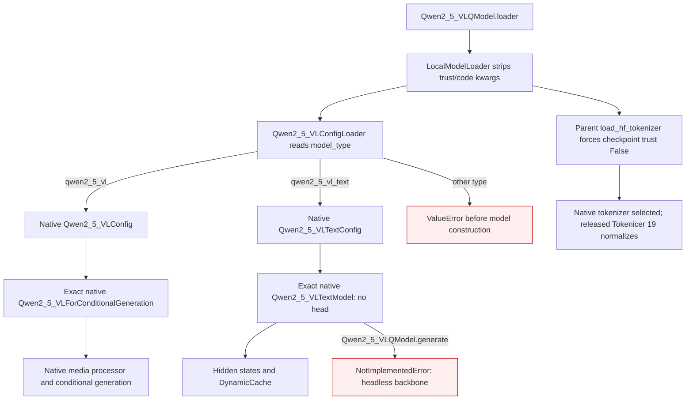
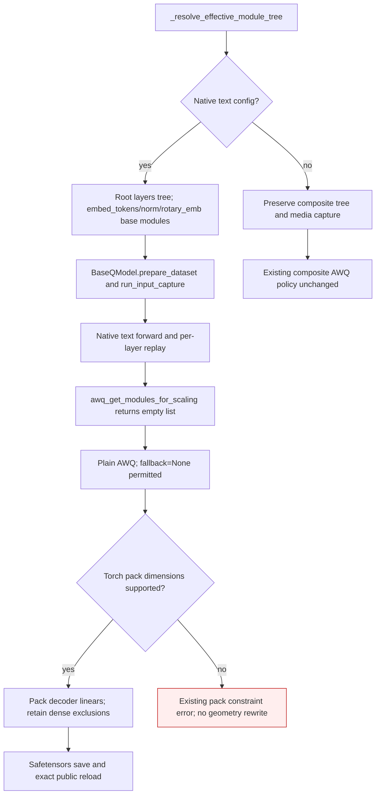

# Qwen2.5-VL native composite and headless text backbone

GPT-QModel selects the exact Transformers 5.23 native classes:
`Qwen2_5_VLForConditionalGeneration` for `qwen2_5_vl`, and
`Qwen2_5_VLTextModel` for `qwen2_5_vl_text`. No decoder, attention, rotary,
vision, cache, or output head is copied or added. The standalone text model
returns `BaseModelOutputWithPast`, including `last_hidden_state` and cache;
it has no `lm_head`, logits, loss, or generation interface. The GPT-QModel
definition explicitly rejects `generate()` for this alias.

## Published contract and provenance

The independently published
[hf-tiny-v2/tiny-random-Qwen2_5_VLTextModel](https://huggingface.co/hf-tiny-v2/tiny-random-Qwen2_5_VLTextModel/tree/3d88ac2485f48cc590e717ba208662768db347e9),
revision `3d88ac2485f48cc590e717ba208662768db347e9`, declares
`model_type="qwen2_5_vl_text"` and
`architectures=["Qwen2_5_VLTextModel"]`. Its actual 19,468,848-byte
safetensors payload was downloaded and SHA-256 verified:
`374de0fbb2e77646fbeaff32fd35fb95d3510cbffaa57032c70a3f14b47f42b6`.
All **26 keys and shapes** match the native headless model. Embeddings,
layers and norm live at the root (`embed_tokens.*`, `layers.*`, `norm.*`);
neither a `model.*` wrapper nor `lm_head.weight` exists. Configuration and
compressed factual shape fixtures are shipped, with asset hashes in
`fixtures/published_headless_reference.json`. No tensor payload is shipped.
This is a tiny-random publication, not trained-model quality evidence.

The root configs among the name-search publications in
`fixtures/standalone_publication_audit.json` declare the composite class or
`qwen2/Qwen2ForCausalLM`; another collection has no root config. None supplies
a `qwen2_5_vl_text` causal-head contract. The native `AutoModel` mapping is
authoritative for this alias. Its absence from the causal-LM and image-text
AutoModel families does not justify adding a head. A composite checkpoint is
not silently converted into a standalone text checkpoint.

Authoritative native implementation and auto mappings are
[Transformers v5.23.0](https://github.com/huggingface/transformers/tree/52b080b6416a7897e2af90febeb4dfad22b84d19/src/transformers/models/qwen2_5_vl),
commit `52b080b6416a7897e2af90febeb4dfad22b84d19`. Installed configuration,
modeling and AutoModel mapping files were byte-compared with that revision.
Apache-2.0 attribution and license are preserved in `NOTICE` and `LICENSE`.

The independent composite inventory is
[Qwen/Qwen2.5-VL-3B-Instruct](https://huggingface.co/Qwen/Qwen2.5-VL-3B-Instruct/tree/66285546d2b821cf421d4f5eb2576359d3770cd3),
revision `66285546d2b821cf421d4f5eb2576359d3770cd3`: its index and both real
safetensors headers supply **824 released keys/shapes**. All match the native
composite meta model after its declared legacy conversion (`visual.*` to
`model.visual.*`, `model.*` to `model.language_model.*`). Native composite
state has 825 entries because its omitted tied `lm_head.weight` is reconstructed
from its embedding. This composite head does not establish a standalone head.
The separate **Qwen Research License** is preserved byte-for-byte in
`LICENSE.Qwen3B`; its narrow `.gitattributes` exception preserves upstream
trailing spaces. No trained weight payload is redistributed. The independent
tiny publication contributes metadata, not code or a license for trained weights.

## Selection, capture and failure paths





| Mechanism | Before | Now |
| --- | --- | --- |
| Definition loader (`qwen2_5_vl.py`, inherited loader) | Image-text AutoModel cannot build the standalone text config | Package metadata selects the exact native class for each alias |
| Standalone task gap | No causal-LM AutoModel mapping | Preserve the published headless backbone; reject generation explicitly |
| Text weight tree (`BaseQwen2VLGPTQ.module_tree`) | Composite `model.language_model.layers` assumption | Separate root `layers` tree without mutating the class tree |
| Text calibration (`BaseQwen2VLGPTQ.prepare_dataset/run_input_capture`) | Media processor/capture assumptions | Base text preparation and capture; no media processor |
| Text AWQ grouping (`BaseQwen2VLGPTQ.awq_get_modules_for_scaling`) | Composite path relationships | Explicit empty groups and measured plain quantization |
| Tokenizer dispatch | Selected config alone could still permit remote tokenizer code with trust+bypass | Canonical parent HF helper forces checkpoint tokenizer trust False |

The parent owns shared loader/security code, central docs and PR diagrams.
This unit requires the exact canonical `models/local.py` and `utils/hf.py`
from parent `b444efaac`; the older selected-config-only prerequisite is
insufficient. No shared causal output, writer or quantizer changes are needed.
Released **Tokenicer 0.0.19** owns normalization; this unit adds no normalization
shim. `central_fixture_proposals.json` contains the exact fusion reason and
central packaging/docs proposal. The default registered composite module plan
is unchanged; text fusion remains unqualified.

The replacement is based directly on `b444efaac`. The earlier causal-head
proposal is superseded and is not an integration prerequisite.

## Validation and deliberate limits

Environment: Python 3.14.6t, `PYTHON_GIL=0`, Transformers 5.23.0, Torch
2.15.0+cpu and released Tokenicer 0.0.19. The owned suite checks exact native
class and key ownership, CPU/meta MHA/GQA/MQA module plans, exclusions and
tree isolation; FP32/FP16/BF16 eager/SDPA hidden states and cache continuation;
full/sliding attention and left padding; assignment and two dense safetensors
cycles; failure/repair/retry; explicit public generation rejection; native
composite image/video forward and greedy/beam generation. Eighteen public
hostile model **and tokenizer** `auto_map` cases cover API trust None/False/True
and bypass unset/0/1 without executing checkpoint Python.

Reinstating the superseded causal class produces two intended regression
failures: exact native-class identity and the independently published root
tensor schema (including its absent head). Removing the mutation restores
both tests. On the replacement base, the full owned suite has **66 passed**;
the combined command below has **843 passed, 463 skipped** (460 NVIDIA Marlin
hardware cases and three absent DeciLM/EXAONE/Nanbeige fixtures). No owned test
is skipped. Full `format/check.sh`, port Pyright, compileall, fixture hashes,
package discovery and `git diff --check` pass.

Six actual public plain-AWQ cases cover MHA/GQA/MQA and disk-offload False/True
with `fallback=None`: all 14 decoder linears pack, embeddings/norms stay dense,
and every packed/dense tensor and hidden output matches through TWO saves and
public reloads. No fold/search/replay relationship is claimed from shape alone.

The actual published tiny payload independently passed exact public/native
hidden-state parity and TWO native dense saves with public reloads, preserving
every tensor and rejecting generation. Its real `intermediate_size=37` is
retained. Existing Torch AWQ correctly rejects its MLP output width because
37 is not divisible by 8. The aligned fixtures qualify all 14 projections;
the published tiny payload is **not** claimed to have completed packed AWQ.

No trained-checkpoint quality, GPU, FlashAttention, fused kernels, multi-GPU,
concurrent PyTorch, compile, training, foreign/static/offloaded/quantized cache,
extended-context or fusion qualification is claimed. Only native DynamicCache
continuation is qualified. The composite media checks use meaningful tiny
images/video patches, not a trained visual-quality benchmark.

Run from the repository root with the isolated environment on PATH:

```bash
export PATH=/home/ubuntu/.venvs/gptqmodel-tf5/bin:$PATH
PYTHON_GIL=0 python -m pytest -q tests/test_qwen2_5_vl_local_port.py tests/module_tree/test_qwen2_5_vl_local_port.py
PYTHON_GIL=0 python -m pytest -q tests/test_qwen2_5_vl_local_port.py tests/module_tree/test_qwen2_5_vl_local_port.py tests/test_local_model_loading.py tests/test_awq_scale_search_safety.py tests/test_awq_moe_router_scaling.py tests/test_awq_empty_groups.py tests/test_awq_position_kwargs.py tests/test_awq_scale_search_memory.py tests/test_bloom_awq_replay.py tests/module_tree/test_awq_relationships.py tests/module_tree/test_bloom_awq_relationships.py tests/module_tree/test_registered_module_plans.py tests/module_tree/test_definition_subset_ordering.py tests/module_tree/test_fusable_models.py tests/module_tree/test_fusable_config.py tests/module_tree/test_fusable_merge.py -ra
bash format/check.sh
git diff --check
```

The complete actual-payload SHA and source pins above allow downloading just
the five data files with `huggingface_hub.snapshot_download(...,
allow_patterns=["config.json", "model.safetensors", "tokenizer.json",
"tokenizer_config.json", "chat_template.jinja"])`; no checkpoint Python is
needed. Construct `Qwen2_5_VLTextModel.from_pretrained` and
`GPTQModel.load(..., dtype=torch.float32, backend=BACKEND.TORCH,
attn_implementation="eager")` from that directory and compare
`last_hidden_state`. For dense cycles use native `model.save_pretrained` and
`tokenizer.save_pretrained`, then public `GPTQModel.load`. The wrapper's
`save()` is the quantized writer and requires a quantized model.

Pinned real Qwen 3B tokenizer validation compares raw Rust serialized-BPE,
native `AutoTokenizer` and `load_hf_tokenizer` against the committed independent
IDs, decode, chat rendering and EOS reference for both aliases, including three
save/reload cycles per alias and immutable source hashes. It passed with
released Tokenicer 19. The fixture records all five SHA-256 pins.
