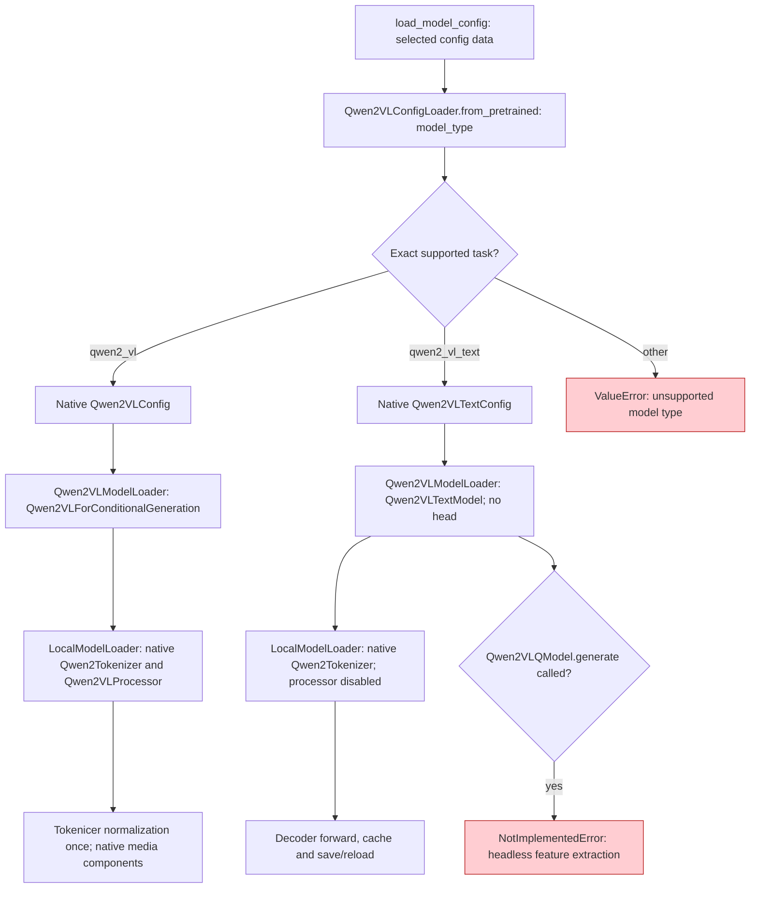
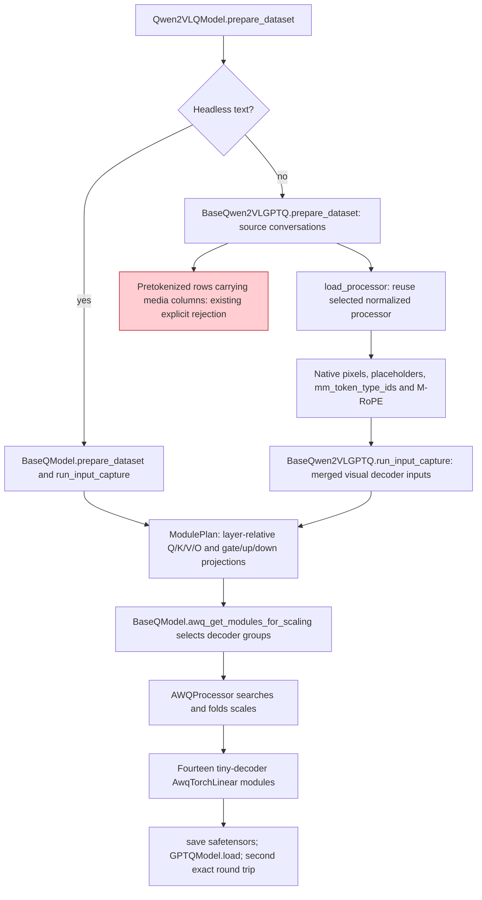

<!-- SPDX-FileCopyrightText: 2026 ModelCloud.ai -->
<!-- SPDX-License-Identifier: Apache-2.0 -->

# Native Qwen2-VL tasks in Transformers 5

`Qwen2VLQModel` selects exact native Transformers classes through a
definition-owned `LocalModelLoader`. No modeling implementation is vendored.

| Checkpoint `model_type` | Exact config/model | Public contract |
| --- | --- | --- |
| `qwen2_vl` | `Qwen2VLConfig` / `Qwen2VLForConditionalGeneration` | Native image/video conditional generation, with its trained-head schema |
| `qwen2_vl_text` | `Qwen2VLTextConfig` / `Qwen2VLTextModel` | Headless decoder / feature extraction, native KV cache, plain quantization and safetensors reload; `generate()` raises `NotImplementedError` |

The standalone text config has a native `AutoModel` mapping, **no** native
`AutoModelForCausalLM` or `AutoModelForImageTextToText` mapping. A published
headless checkpoint contains `embed_tokens`, `layers` and `norm`, without
`model.` or `lm_head`. Inventing an output head would change its task and
silently introduce random parameters. This adapter never adds a causal wrapper.

## Selection and failure paths



Config and model class paths are package metadata. `auto_map`, checkpoint
Python class names, `trust_remote_code` and `code_revision` cannot replace them.
The parent loader contract forces tokenizer trust false for owned models and
passes the selected config. Direct native `Qwen2VLProcessor` construction
receives that config and the underlying Tokenicer-normalized tokenizer.
Image/video components are the processor's native classes. No checkpoint Python
is imported, including with explicit trust and the safety bypass together.

| Previous mechanism | Resulting mechanism |
| --- | --- |
| `22bea1201:gptqmodel/models/definitions/qwen2_vl.py` inherited the image-text auto loader for both aliases | `Qwen2VLModelLoader._model_class` chooses exact native classes by exact native config type |
| Headless alias reached a task family without a mapping | Native feature extraction loads with the real headless parameter schema; generation rejects explicitly |
| `BaseQwen2VLGPTQ` assumed `model.language_model.layers` / visual modules | Definition-scoped text tree is `layers.#`; text capture, dataset handling and materialization use existing `BaseQModel` behavior |
| Conversation calibration rediscovered a processor/tokenizer | `Qwen2VLQModel.load_processor` reuses the processor already bound to the normalized tokenizer |
| Empty scaling groups in the initial port | Shared decoder scale search uses the native capture for both aliases |

## Capture and AWQ



The public AWQ tests pass
`fallback=None`, calibrate composite models from source PIL-image conversations,
compare captured first-decoder inputs against the native dense model, pack all
fourteen decoder linears, confirm the input norms were folded, and compare every
packed/dense tensor after **two** reloads. Both disk-offload settings and legacy
composite `model.*`/`visual.*` keys with the omitted tied-head alias are covered.
No shared AWQ implementation is modified.

## Pinned evidence and provenance

`provenance.json` records exact source revisions, installed runtime source hashes
and asset hashes. `checkpoint_shapes.json.gz` contains header shapes, not tensors.

| Source | Immutable revision | Independent inventory |
| --- | --- | --- |
| [Qwen/Qwen2-VL-2B-Instruct](https://huggingface.co/Qwen/Qwen2-VL-2B-Instruct/tree/895c3a49bc3fa70a340399125c650a463535e71c) | `895c3a49bc3fa70a340399125c650a463535e71c` | All 729 tensors from both actual safetensors headers; native meta state adds one tied `lm_head.weight` alias and uses native key conversion |
| [hf-tiny-v2/tiny-random-Qwen2VLTextModel](https://huggingface.co/hf-tiny-v2/tiny-random-Qwen2VLTextModel/tree/8e524159e711c11ee700c298ed55d773bc95328e) | `8e524159e711c11ee700c298ed55d773bc95328e` | All 26 actual headless header keys/shapes; this is a random test checkpoint, not evidence of trained standalone causal weights |

The offline processor bundle preserves the source `tokenizer.json`,
`tokenizer_config.json`, `preprocessor_config.json` and `chat_template.json`.
Literal Latin/CJK/Greek/Arabic/emoji token-ID oracles come from the serialized
Rust backend independently of Tokenicer. The source chat prompt is asserted
literally. Independent pixel rescaling/normalization/merge-order equations check
the real patch-14 processor; processor serialization is checked for every output.
Real image-conditioned logits and greedy generation are exercised with a tiny
random native decoder enlarged only to the released tokenizer vocabulary.

The installed Transformers 5.23.0 Qwen2-VL source is Apache-2.0. `LICENSE` is
byte-preserved from the pinned official checkpoint; `NOTICE` describes the data
and native imports. No remote Python was run to discover behavior. Config,
tokenizer/processor assets and safetensors JSON headers were read as data only.

## Reproduction

Validated with Python 3.14.6t (`sys._is_gil_enabled() == False`), CPU Torch
2.15.0, Transformers 5.23.0 and directly inspected released Tokenicer 0.0.19.
Early development used installed Tokenicer 0.0.14; the final qualification uses
0.0.19. The native implementation and tokenizer normalization remain upstream.

```bash
PYTHON_GIL=0 /home/ubuntu/.venvs/gptqmodel-tf5/bin/python -m pytest -q \
  tests/test_qwen2_vl_local_port.py tests/module_tree/test_qwen2_vl_local_port.py

PYTHON_GIL=0 /home/ubuntu/.venvs/gptqmodel-tf5/bin/python -m pytest -q \
  tests/test_awq_scale_search_safety.py tests/test_awq_moe_router_scaling.py \
  tests/test_awq_empty_groups.py tests/test_awq_position_kwargs.py \
  tests/test_awq_scale_search_memory.py tests/test_bloom_awq_replay.py \
  tests/module_tree/test_awq_relationships.py \
  tests/module_tree/test_bloom_awq_relationships.py \
  tests/module_tree/test_registered_module_plans.py \
  tests/module_tree/test_definition_subset_ordering.py

PATH=/home/ubuntu/.venvs/gptqmodel-tf5/bin:$PATH format/check.sh
git diff --check
```

The final combined owned/AWQ/registry/loader/security/fusion run passed **798**,
including **92** owned tests, in **32.97s**, with **471** skips and ten warnings.
There were no failures or deselections. The mandatory AWQ/registry baseline passed **574**, with **3** existing remote
fixture skips (DeciLM, Exaone, Nanbeige). The shared loader/security/fusion run
passed **132**, with **468** NVIDIA fusion hardware skips. Full Ruff 0.14.2
`format/check.sh`, compileall, package discovery and `git diff --check` passed.
The older-base generic processor suite requires the independently owned parent
InternLM package and cannot collect on this isolated branch; it is not included
in these counts. The owned native processor/media/public-security tests are
included and passed. The existing trained CUDA model test was not executed.

Meaningful negative probes, with the same assertions retained:

* Restore the original image-text-only selector: the headless native task test
  fails with the missing `Qwen2VLTextConfig` mapping (one red).
* Remove owned `load_processor` reuse: actual image-calibrated AWQ captures
  twelve tokens instead of the six produced by the selected normalized processor
  (one red); the repaired public path packs and round-trips normally.
* Replace native three-axis rotary recomposition with one text axis: all six
  independent FP64 MHA/GQA/MQA eager/SDPA decoder oracles fail. Nonuniform T/H/W
  positions matter: constant offsets per axis are translation-invariant and do
  not detect this defect. All six unmodified native cases pass.

## Integration and limits

Parent-owned central work: preserve the unchanged default
`Qwen2VLQModel/gptq` registry fixture and composite fusion admission; update only
the text fusion reason from `central_fixture_proposals.json`. Copy these Mermaid
flows and task distinction into the central coverage docs/PR and link from the
main README. Package LICENSE, NOTICE, provenance JSON and compressed fixtures.
No generic AWQ family-set change is required.

This unit qualifies CPU native execution and AWQ scale search on tiny fixtures, not trained
weight quality, full trained payload loading, GPU/FlashAttention/fused kernels,
multi-GPU, concurrent PyTorch execution, compile/training, extended context,
foreign/static/offloaded/quantized caches, or media-container decoding. Video
tests use PIL frames. Headless generation is intentionally unsupported. Fusion
remains unavailable for the headless task; no new composite fusion claim is made.
