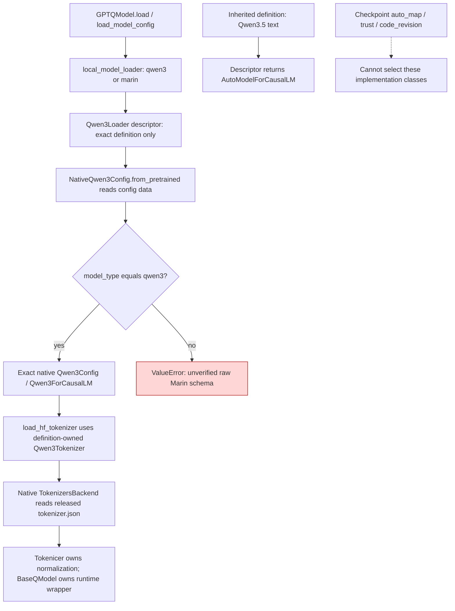
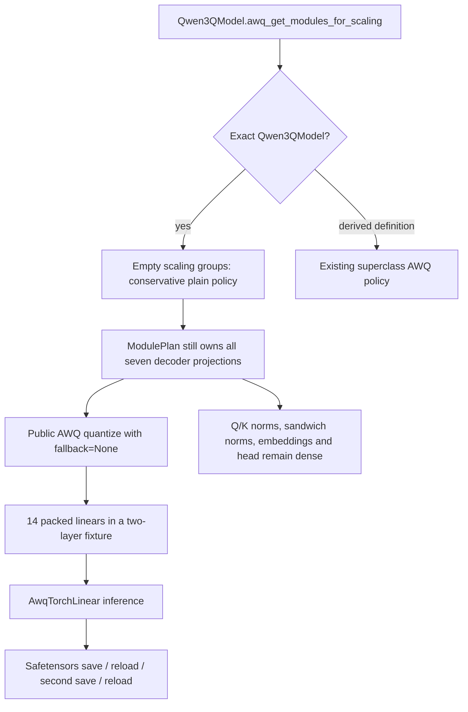

# Native Qwen3 and the Marin QK-Norm release

`Qwen3QModel` selects the exact installed Transformers `Qwen3Config` and
`Qwen3ForCausalLM`. No modeling implementation is duplicated. The supported
[Marin-32B release](https://huggingface.co/marin-community/marin-32b-base/tree/f19b346615212ff9a6d92c10861a9cdb100cbf97)
explicitly serializes `model_type=qwen3` and `Qwen3ForCausalLM`; its model card
describes the Qwen3 QK-Norm backbone. Its complete 707 tensor keys/shapes match
native Qwen3 on meta, including the two per-head norms. The corresponding
[Qwen3-0.6B release](https://huggingface.co/Qwen/Qwen3-0.6B/tree/c1899de289a04d12100db370d81485cdf75e47ca)
has 311 matching keys/shapes. Marin's earlier Llama-based training phases are
not evidence for a distinct `marin` architecture.

Raw `model_type=marin` is rejected before remote-code permission handling. A
registry alias cannot prove that an unknown schema is Qwen3. Restoring an
original Qwen3 release config repairs a mislabeled supported fixture; relabeling
an unknown model is not a supported conversion.

## Selection and failure contract



`Qwen3Tokenizer` is an alias to native `TokenizersBackend`, also known as
`PreTrainedTokenizerFast`. Both inspected releases use its serialized BPE
format. Direct native selection prevents hostile tokenizer `auto_map` from
overriding the definition when both trust and the security bypass are enabled.
No tokenization or normalization algorithm is implemented here. Released
Tokenicer 0.0.19 supplies normalization. Qwen3.5 text inherits the projection
definition but retains its own native model selection.



Q/K per-head normalization occurs after Q/K projection. A projection tree does
not establish fold/search/replay safety. This change deliberately performs no
AWQ scale search or folding for this definition. All seven projections remain
quantizable. Native Qwen3 fusion declarations and registry module ordering are
unchanged; this work does not add a fusion qualification.

| Mechanism | Before (base 22bea1201) | After |
| --- | --- | --- |
| `definitions/qwen3.py:10` model loader | Inherited AutoModel path; checkpoint metadata participates in selection | Definition-owned exact native classes |
| `utils/hf.py:1017` raw `marin` dispatch | No verified native mapping; remote trust policy may be reached | Explicit schema failure before checkpoint Python |
| `utils/hf.py:2958` tokenizer selection | Ordinary AutoTokenizer may honor hostile tokenizer mapping under trust+bypass | Native serialized BPE class selected by definition, normalized by Tokenicer |
| Qwen3 AWQ grouping | Inherited generic grouping | Explicit plain quantization; seven projections retained |
| Derived Qwen3.5 loader | Native AutoModel | Native AutoModel, pinned by regression |

## Provenance and fixture ownership

- Native Transformers 5.23.0 tag commit:
  `52b080b6416a7897e2af90febeb4dfad22b84d19`.
  `native_sources.json` records pinned native source URLs and SHA-256, and
  confirms the installed config/model source hashes match those files.
- Marin-32B: `f19b346615212ff9a6d92c10861a9cdb100cbf97`.
- Qwen3-0.6B: `c1899de289a04d12100db370d81485cdf75e47ca`.
- `fixtures/manifest.json` records original URL, uncompressed bytes and SHA-256.
  Gzip fixtures preserve original metadata, tokenizer, model card and license
  bytes. `headers.json.gz` is a derived tensor-name/shape/dtype inventory from
  bounded HTTP range reads of all 14 Marin shards and the single Qwen3 shard.
  No model tensor payload or checkpoint Python was downloaded.
- See `LICENSE`, `TRANSFORMERS_LICENSE`, `NOTICE` and the retained model cards
  for attribution. The adapter's code is Apache-2.0. These fixtures do not
  redistribute training datasets or pretrained model tensors.

## Validation

Run from the repository root with the isolated environment:

```bash
PYTHON_GIL=0 /home/ubuntu/.venvs/gptqmodel-tf5/bin/python -s -m pytest -q \
  tests/test_qwen3_local_port.py tests/module_tree/test_qwen3_local_port.py
```

The tests use real native models and released tokenizer assets. Coverage includes
all pinned released tensor keys/shapes, CPU/meta MHA/GQA/MQA with biases and
independent head dimensions, explicit float64 attention/QK norm/RoPE/MLP
equations (default and Llama3 RoPE near position 65535, full/sliding attention),
FP32/FP16/BF16 eager/SDPA, causal suffix isolation, cache continuation in
1+4+1-token chunks, assign=False/True, greedy/beam generation, original generation
policy fields, Latin/CJK token IDs and Qwen chat templates, exact dense state
and two safetensors cycles. Public native loads cover both releases with trust
False/True and bypass unset/0/1, hostile config/model/tokenizer/custom-generate
files, and raw-Marin failure followed by repair/retry. Twelve public plain-AWQ
cases cover both releases, MHA/GQA/MQA+bias and disk-offload False/True, actual
packing/inference, all fourteen projections, every excluded dense tensor and
two exact packed-state safetensors reloads.

The original raw-Marin regression was red before the binding (including actual
sentinel execution under trust+bypass). The public hostile-tokenizer regression
also reproduced checkpoint execution before the explicit native tokenizer
binding, even after supplying the selected model config to AutoTokenizer.
Removing only `tokenizer_class` from the loader reproduced two intended public
checkpoint-execution failures in 1.53s. Reducing native Q/K norm outputs by 10%
made all 24 independent decoder equations fail in 1.49s; those same cases pass
without the mutation.

Measured final owned run: **102 passed, zero skipped, 60.18s** on Python 3.14.6t,
GIL disabled, Torch 2.15.0+cpu, Transformers 5.23.0, released Tokenicer 0.0.19,
SentencePiece 0.2.3. The installed native source hashes match the pinned native
revision. The shared regression command was:

```bash
PYTHON_GIL=0 /home/ubuntu/.venvs/gptqmodel-tf5/bin/python -s -m pytest -q \
  tests/test_local_model_loading.py tests/test_local_tokenizer_loading.py \
  tests/test_local_processor_loading.py tests/test_internlm_local_port.py \
  tests/module_tree/test_registered_module_plans.py \
  tests/module_tree/test_fusable_models.py tests/test_awq_scaling_groups.py \
  tests/test_awq_scale_search_safety.py \
  tests/module_tree/test_awq_fold_safety_4175.py \
  tests/test_awq_gptq_lifecycle.py \
  tests/test_awq_modules_to_not_convert_lifecycle_4309.py
```

Result: **758 passed, 475 skipped, 9 warnings, 24.86s**. Skips comprise 468 NVIDIA
fusion numerical cases, one GPU-only AWQ math case, four missing local remote
model fixtures (Pangu twice, Instella, K2 Horizon), and two nonbuildable CausalLM
fixtures (OPT-350 and Muse Glimmer). No test was deselected. `format/check.sh`
passes the whole-repository Ruff 0.14.2 gate. Setuptools discovers the package.

No full trained-weight inference, quality evaluation, GPU/FlashAttention,
multi-GPU, threaded PyTorch execution, torch.compile, training, static/offloaded/
quantized/foreign KV caches, full long-context quality or new fusion numerical
qualification is claimed. Existing trained Marin evaluation tests need their
uncached multi-GB checkpoints and suitable hardware.

The parent integrator owns the shared docs/README/PR diagrams and package-data
inclusion for `LICENSE`, `NOTICE`, `TRANSFORMERS_LICENSE`, JSON and gzip fixtures.
The existing registered module plan needs no change. The stale central `marin`
fusion reason should say: `Raw marin metadata is unqualified; supported
Marin-32B releases serialize native qwen3 and use its existing fusion contract.`
