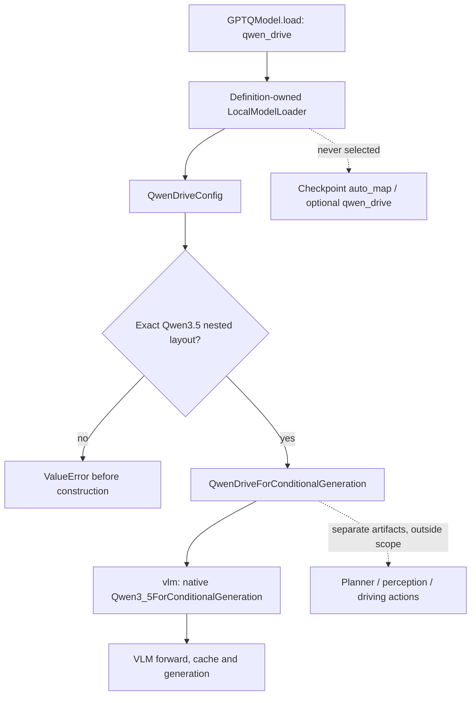
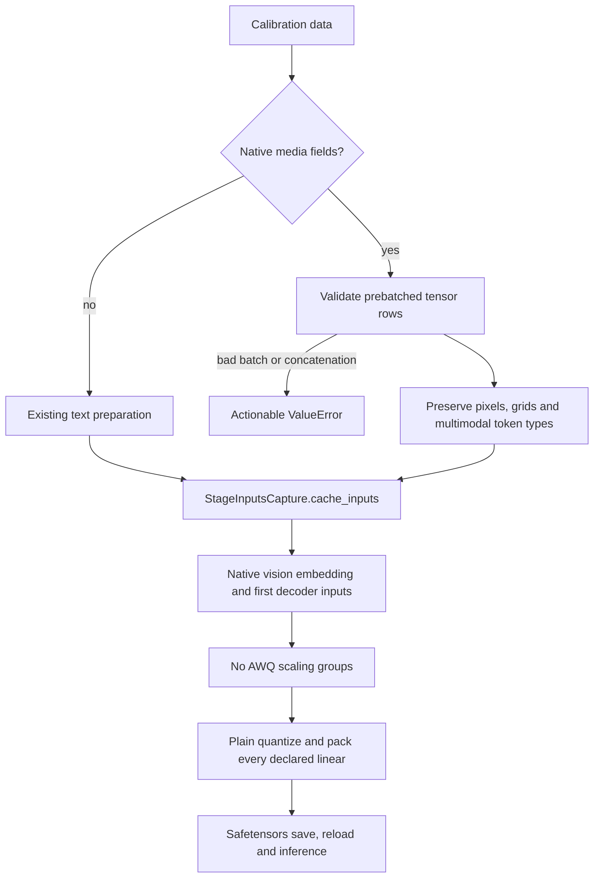

<!-- SPDX-FileCopyrightText: 2026 ModelCloud.ai -->
<!-- SPDX-License-Identifier: Apache-2.0 -->

# Qwen-Drive root VLM ownership

GPT-QModel owns the root Qwen-Drive configuration and wrapper, and binds its
`vlm` directly to the exact native Transformers 5 Qwen3.5 model. The optional
official `qwen_drive` package, global AutoConfig registration, and checkpoint
Python are not used. This preserves the definition's existing **VLM-only**
scope: separately released planning/perception models are not part of this port.

## Authoritative implementation and checkpoint

| Item | Pinned source |
| --- | --- |
| Official implementation | [QwenLM/Qwen-Drive-1.0](https://github.com/QwenLM/Qwen-Drive-1.0/tree/28091c1532e869bc7aee91fc0aef6b3e6fd0b2e0), Apache-2.0 |
| Upstream configuration | `src/qwen_drive/configuration_qwen_drive.py:91-174` |
| Upstream root wrapper | `src/qwen_drive/modeling_qwen_drive.py:97-132`; native VLM construction at `:105`, text generation at `:394-424` |
| Released checkpoint | [Qwen/Qwen-Drive-1.0-4B](https://huggingface.co/Qwen/Qwen-Drive-1.0-4B/tree/28484089a7cc8c335cf5089fb0745cf7c49b6eaa) |
| Native runtime checked | Transformers 5.23.0, `Qwen3_5Config` / `Qwen3_5ForConditionalGeneration` |
| Root native availability | No `qwen_drive` native config or selected AutoModel mapping in that version |

`LICENSE` preserves the upstream license. `NOTICE` attributes the adaptation.
`fixtures/provenance.json` records source and released-asset SHA-256 values.
Fixtures contain config, tokenizer/chat/image-processor metadata and the full
safetensors header, **not tensor payloads**. Only the released root was inspected;
there is no claim to support an unknown Qwen-Drive alias by similarity.

The released root declares `QwenDriveForPlanning`, but its 723 stored tensors
are exclusively `vlm.*`. The package model's 724 state entries match every
released shape, with the sole additional entry being the source-omitted tied
`vlm.lm_head.weight` alias. All 32 decoder layers are accounted for, including
full attention at layers 3, 7, 11, 15, 19, 23, 27 and 31 and recurrent attention
elsewhere. The package wrapper does not initialize an untrained planner merely
to delete it afterwards.

## Selection flow

Before this port, `utils/hf.py:ensure_qwen_drive_registered` imported the optional
official stack before AutoConfig; `definitions/qwen_drive.py` used AutoModel and
removed a freshly initialized planner in `after_model_load`. The package-owned
loader now takes precedence. Shared selection/security code is parent-owned;
this port does not introduce another registration or security implementation.



| Mechanism | Before | After |
| --- | --- | --- |
| Root config/model ownership | Optional official package registration | Fixed package-owned classes |
| Nested VLM | AutoModelForImageTextToText config dispatch | Exact native Qwen3.5 class |
| Planner initialization | Random planner created then removed | No planner instantiated |
| Trust/bypass toggles | Optional registration preceded owned selection | Neither can replace package-owned code |
| Generation policy | Outer wrapper could lose root metadata | Root `GenerationConfig` passed to native generator |
| Recurrent state owners | Parent-owned `A_log` / `dt_bias` not covered | Explicit excluded `linear_attn:!` parent |
| Media calibration | Generic text preparation discarded media | Native tensor rows retained with image/video grids |
| AWQ optimization | Generic relationships inherited | Explicit plain quantization, no guessed scale folds |

## Calibration and quantization flow

Prepared native VLM tensors may be passed as one mapping or an iterable of
mappings. Use `batch_size=1`: each row is already a native batch, including its
own image/video patch layout and token alignment. Concatenation and malformed
mixed rows fail explicitly. Existing minimum-length and sort options apply via
the shared VLM calibration helper. Plain text keeps the normal text path.



### Explicit AWQ policy

Both full-attention and hybrid layouts are **plain quantization only**. Native
full attention contains gated queries, per-head Q/K norms and rotary attention;
linear attention contains packed QKV, convolution, recurrent delta updates,
exponential decay, sigmoid/SiLU gates and gated RMS normalization. Adjacency or
matching widths cannot justify folding through those operations. The package
returns no scaling groups; it makes no fold/search/replay safety claim.

The four actual public CPU AWQ tests cover hybrid/full layouts with disk offload
false/true and `fallback=None`. They independently capture the native reference's
first decoder input and compare it **exactly** with the actual calibration
capture, including non-degenerate visual embeddings. All 13 hybrid or 14
full-attention decoder linears pack; every excluded dense tensor is unchanged at
the requested dtype. Every packed/dense tensor and logits remain exact through
two saves/reloads. `fallback=None` does not disable the intentional no-group
plain path. Vision, embeddings, output head, convolution, norms, `in_proj_a`,
`in_proj_b`, `A_log` and `dt_bias` remain dense. Native Qwen3.5 declares no root
strict-FP32 preservation policy; none is invented by this wrapper.

## Regression evidence

Runtime: Python 3.14.6t, `PYTHON_GIL=0`, Torch 2.15.0+cpu, Transformers 5.23.0,
published Tokenicer 0.0.19. The initial snapshot contained Tokenicer 0.0.14;
final qualification explicitly upgraded and audited the installed version.

Owned coverage includes CPU/meta MHA/GQA/MQA with/without attention bias;
hybrid/full/linear layouts; independent native-Qwen3.5 numerical references;
FP32/FP16/BF16; eager/SDPA; image/video/text forwards; 1+4+1 cache continuation;
greedy/beam generation; assignment false/true; two dense safetensors cycles;
corrupt-payload and malformed-subfolder config repair/retry; exact released
inventory and module-plan flags, exclusions and negative descendants.

Six public trust false/true × bypass absent/0/1 tests prohibit the optional
official import and checkpoint config/model/tokenizer/custom-generation
sentinels. Six additional public cases use the **actual pinned release BPE and
chat assets**, multilingual/combining-accent/whitespace/special-token IDs from
an independent raw Rust-tokenizer oracle, exact chat rendering, image forward,
generation, and two dense model/tokenizer reloads. No tokenizer normalization
shim is added; Tokenicer owns normalization.

Meaningful red/green evidence:

| Removed/broken behavior | Observed red | Restored behavior |
| --- | --- | --- |
| Original AutoModel ownership | Loader contract assertion fails | Fixed LocalModelLoader |
| Old unconditional registration hook | Public hostile case attempts optional import | Parent shared ownership-first guard; all public cases green |
| Generic text calibration | All four image-AWQ captures differ at visual tokens | Native tensor rows preserved; exact captures and reloads |
| Discard root GenerationConfig | Root policy consumer fails with missing scores/default length | Root EOS/limits/scores survive two saves |

The mutation probes run only in isolated test processes, never in shipped code.
The observed first image-capture red differed by up to 0.0887451171875 in FP16;
this was not accepted by loosening a tolerance.

### Reproduction

| Gate | Result |
| --- | --- |
| Owned runtime and module-plan suites | 106 passed, no skips, 29.03 seconds |
| Required CPU AWQ baseline below | 574 passed, three pre-existing remote-fixture skips, 6.29 seconds |
| Expanded loader/InternLM/registry/AWQ/fusion run | 931 passed, 477 skipped, one unrelated old Ling assertion deselected, 53.33 seconds |

The expanded skips are 468 NVIDIA Marlin hardware cases, four unavailable
scaling-group checkpoint cases (two PanGu, Instella, K2-Horizon), three unavailable
position-kwargs checkpoints (DeciLM, EXAONE, Nanbeige), and two explicitly
non-buildable CausalLM fixtures (OPT-350 and Muse-Glimmer). No owned case skips.

```bash
export PYTHON_GIL=0
PY=/home/ubuntu/.venvs/gptqmodel-tf5/bin/python
$PY -s -m pytest -q tests/test_qwen_drive_local_port.py tests/module_tree/test_qwen_drive_local_port.py
PATH=/home/ubuntu/.venvs/gptqmodel-tf5/bin:$PATH bash format/check.sh
git diff --check
```

The required CPU AWQ baseline is run with the exact proposed Qwen-Drive
registered-plan case applied **only in memory**, not by editing central files:

```python
import json
import pytest
import tests.module_tree.test_registered_module_plans as registry

proposal = json.load(open("gptqmodel/models/ports/qwen_drive/central_fixture_proposals.json"))
registry.INVENTORY["cases"].update(proposal["registered_module_plans"]["cases"])
raise SystemExit(pytest.main([
    "-q", "-rs",
    "tests/test_awq_scale_search_safety.py", "tests/test_awq_moe_router_scaling.py",
    "tests/test_awq_empty_groups.py", "tests/test_awq_position_kwargs.py",
    "tests/test_awq_scale_search_memory.py", "tests/test_bloom_awq_replay.py",
    "tests/module_tree/test_awq_relationships.py",
    "tests/module_tree/test_bloom_awq_relationships.py",
    "tests/module_tree/test_registered_module_plans.py",
    "tests/module_tree/test_definition_subset_ordering.py",
]))
```

This baseline passed 574 cases with three existing missing remote-fixture skips:
DeciLM, EXAONE and Nanbeige. Ruff 0.14.2's full repository gate passes. Default
Pyright on the two runtime files reports two native Transformers
`GenerativePreTrainedModel` protocol binding errors for native generation and
preparation delegation; **the type check is not clean**.

For the expanded run, import `tests.module_tree.test_fusable_models as fusion`,
apply `fusion.INVENTORY.update(proposal["fusable_models"]["models"])` in the same
process, and add these paths to the baseline list:

```python
[
    "tests/test_local_model_loading.py", "tests/test_internlm_local_port.py",
    "tests/module_tree/test_internlm_local_port.py",
    "tests/test_qwen_drive_local_port.py", "tests/module_tree/test_qwen_drive_local_port.py",
    "tests/module_tree/test_fusable_models.py", "tests/test_awq_scaling_groups.py",
]
```

Use `-k not test_unported_layout_fails_instead_of_loading_incompatible_native_model`
as two argument-list elements: `"-k"` followed by the entire expression. The
excluded old Ling assertion was executed first and failed; neither its source
nor the shared guard was changed in this unit. No Qwen-Drive case is deselected.

## Parent integration contract

`central_fixture_proposals.json` contains the exact registry case and fusion
reason to apply centrally. The sole registry delta is an excluded
`linear_attn:!` block before its norm/conv/QKV block. The parent owns the stale
`tests/test_qwen_drive_support.py` migration, central docs/README/PR diagrams and
package-data inclusion of LICENSE/NOTICE/JSON/gzip/Jinja fixtures. No shared
source or central fixture edits belong to the owned port commit.

Shared prerequisites used for this unit's validation are the parent InternLM1
and tokenizer-config security patch (5423ad629), plus the parent-approved exact
`utils/hf.py` at 3c177fbe7 and `models/local.py` at b444efaac. Do not integrate
those prerequisite copies again. The snapshot's unrelated old Ling
`test_unported_layout_fails_instead_of_loading_incompatible_native_model`
assertion no longer matches the current shared guard: it was first executed
and failed, then explicitly deselected only in the expanded combined run.

## Explicit limits

- Planner-SFT/RL, perception, scene/frame assembly, trajectory/action generation
  and driving safety are not implemented or evaluated.
- Caller-prepared native image/video tensors are qualified; automatic loading
  of the official driving processor, video containers and camera/time assembly
  are outside this definition's unchanged `require_load_processor=False` policy.
- The released hybrid cache and tiny full-attention cache are qualified.
  All-linear native cache creation rejects a layout without an attention layer;
  its uncached forward is tested and subsequent retry remains usable.
- No trained tensor payload, quality benchmark, GPU/FlashAttention/fused FLA,
  multi-GPU, foreign/static/offloaded/quantized cache, long-context extrapolation,
  compiled/training or concurrent PyTorch execution is qualified.
- Fusion remains disabled. No AWQ scale-fold/search optimization is qualified.
  Existing trained-model evaluation was not run without its local checkpoint.
