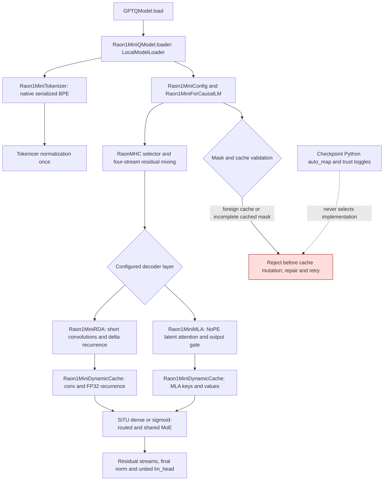
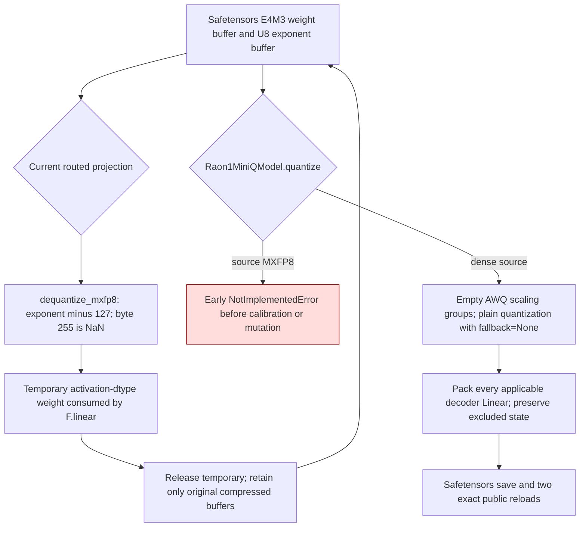

<!-- SPDX-FileCopyrightText: 2026 ModelCloud.ai -->
<!-- SPDX-License-Identifier: Apache-2.0 -->

# Raon package-owned model and compressed expert lifecycle

The Raon definition selects its configuration, model and serialized native BPE
tokenizer directly. Checkpoint `auto_map`, `trust_remote_code` and the remote-code
bypass never select executable code for this model. This port preserves Raon's
actual architecture, not a native DeepSeek substitute. Transformers 5.23.0 has
neither a `raon1_mini` config mapping nor a causal-LM mapping.

## Provenance

Authoritative source: [KRAFTON/Raon-1-mini-preview](https://huggingface.co/KRAFTON/Raon-1-mini-preview/tree/1b4f494d71dff50318288309f64c72aa8c11340e),
revision `1b4f494d71dff50318288309f64c72aa8c11340e`. See the byte-preserved Apache-2.0
`LICENSE`, attribution/modification `NOTICE`, and `source_manifest.json` containing
SHA-256 hashes of inspected source, config, tokenizer, chat template, release
index and all seven real safetensors headers. No checkpoint Python was executed
to derive this port or its independent numerical oracle.

`released_tensors.json` is the independently read union of those seven header
inventories: **19,434 keys** (9,216 E4M3, 9,216 U8, 892 BF16, 110 F32). Every name,
shape and storage dtype matches a real released-config meta instantiation, with
no invented conversion or missing auxiliary weights. The original index and
header hashes are distinct from trained tensor-payload validation.

The test reads `tokenizer.json` from the pinned release (SHA-256 `47752d33008f5dd7cc91d875f1b798d1f1ad8f6a0e84aac9e67cbb49f9da16af`).
`tokenizer_reference.json` pins independently generated raw-Rust-tokenizer IDs,
decode and chat text for English/Korean/CJK/emoji, code, whitespace, special-token
text, combining accents and NUL. Release config/template/generation fixtures
retain their upstream bytes. Runtime loading never reads these test fixtures or
downloads Python. Tokenicer owns normalization; there is no port normalization
shim or registration in global Hugging Face mappings.

## Dispatch and execution



The released layout is 25 layers: 18 RDA and seven MLA, 40 attention heads,
`q_lora_rank=576`, one dense first MLP, then 128-expert top-six routing with one
shared expert. Tests also exercise all-RDA/all-MLA and both hybrid orders,
two/three/four mHC streams, dense-only, shared-expert-free, non-renormalizing
routing, periodic layout ownership and optional MLA output gating.

RMS normalization, mHC selection/mixing, SiTU, routing, attention softmax and RDA
state arithmetic follow the inspected source's FP32 computation boundaries.
`A_log`, `dt_bias`, correction bias and mHC `eta` additionally remain strict F32
storage through public load and quantized reload; other gains use model storage
dtype with FP32 arithmetic where specified. Independent full-decoder equations
test these boundaries rather than deriving expected results from port helpers.

## Compressed storage and quantization



The E4M3 buffers are not dense floating parameters. Dtype/device movement preserves
the one-byte weights and U8 scales. Per-projection expansion is consumed during
the current no-grad inference call; no stacked expert rebinding, dense expanded
cache, global quantizer patch, optional CUDA import or hidden fast path exists.
Tests cover every U8 exponent, repeated forward, in-place payload/scale mutation,
weak-reference lifetime, and two exact compressed safetensors cycles.
An independent sign/exponent/fraction oracle additionally covers all **65,536
E4M3/E8M0 byte pairs** in FP32, FP16 and BF16, including subnormals, signed zero,
the maximum finite E4M3 value, both E4M3 NaN encodings and E8M0 byte 255. The
entire byte inventory survives dtype movement and two safetensors cycles exactly.

**AWQ is plain quantization only, not fold/search qualification.** mHC selectors
read multiple residual streams; RDA has convolution, normalization, write/erase
gates and recurrent state; MLA has latent normalization and attention; SiTU is
nonhomogeneous; routing and shared experts have additional consumers. Widths do
not justify affine folds through these boundaries. The definition returns no
scaling groups for every layout. Eight actual public dense-source AWQ cases
(four attention layouts, disk-offload false/true) use `fallback=None`, capture
the independent expected first-layer stream input, pack all supported linears,
infer, and perform two exact packed/dense-state safetensors reload cycles.
The released compressed source format is loadable but its re-quantization is
explicitly unqualified and rejects before model mutation.

## Before and after

| Concern | Before, starting at 22bea1201 | Local implementation |
| --- | --- | --- |
| Selection | Definition line 11 required remote trust; no local loader | Explicit packaged config/model/tokenizer |
| Checkpoint behavior | External model implementation | Exact released tensor inventory and equations |
| Module plan | Missing RDA controls and MLA norms; stale dense expert paths | Live CPU/meta owners plus actual public quantization |
| Expert storage | Source native grouped-GEMM and quantizer monkeypatch paths | Persistent E4M3/U8, bounded current-projection expansion |
| AWQ scaling | Inherited groups without Raon-specific proof | Explicit empty groups; all dense-source linears still pack |
| Failure | External/cache-specific behavior | Foreign-cache/mask/config rejection and repaired retry tests |

## Reproducible validation

Validated using Python 3.14.6t with `PYTHON_GIL=0` and the GIL observed disabled,
Transformers 5.23.0, Torch 2.15.0+cpu and published Tokenicer 0.0.19. The port
does not change dependency files. No CUDA device or trained multi-GB weights
are necessary for these tests. The qualified base is the direct merged-parent
commit `bf4003dabad138a9245e55c87151d354a632bb97`; no prerequisite copies are part
of this port. All owned public quantization calls use the current
`CalibrationConfig(dataset=..., batch_size=..., min_length=..., concat_size=...)`
API, with `backend` outside that calibration object. No legacy-API shim is added.

```bash
export PYTHON_GIL=0
PY=/home/ubuntu/.venvs/gptqmodel-tf5/bin/python
$PY -m pytest -q tests/test_raon1_mini_local_port.py \
  tests/module_tree/test_raon1_mini_local_port.py --tb=short
$PY -m compileall -q gptqmodel/models/ports/raon1_mini
format/check.sh
git diff --check
```

The required AWQ CPU baseline, shared loader/path/tokenizer and module registry
tests are also run together. The exact Raon fixture proposal is applied **only
in memory** for the shared registry run: parent-owned central fixtures are not
edited. See `central_fixture_proposals.json` for the complete registered plan
replacement and explicit unqualified fusion reason. `raon1_mini` is absent from
the generic AWQ scaling-family list, so no generic plain-family edit is needed.

Red/green evidence: initial local-ownership regression; early public AWQ exposed
unpacked RDA targets and drove plan-order repair; compressed public load exposed
floating-parameter dtype rejection and drove buffer ownership. A deliberate 10%
RDA decay mutation produces **12 intended failures and four MLA controls**
(2.53 s), restored equations pass. Full U8 exponent testing caught byte-255
infinity rather than NaN (**one intended failure**, 2.41 s); repaired decoding
plus full-decoder numerical cases give **17 passes** (2.40 s). Interpreting the
same E4M3 bytes incorrectly as FNUZ produces **three intended failures**
(2.46 s), including 64,591/65,536 mismatches in FP32. The unmodified bit oracle
passes all three dtypes in 2.51 s. Final owned validation on the qualified base:
**136 passed, zero skipped**, 32.12 s.

The final combined run on that same base is **919 passed, 463 skipped, one
deselected**, 40.14 s. Skips are 460 NVIDIA/Marlin hardware cases and three
unavailable DeciLM/Exaone/Nanbeige fixtures. The explicitly deselected shared
`test_quantized_reload_retains_once_normalized_wrapper` still uses legacy
calibration kwargs on this base: the preceding unfiltered run actually failed
that one test (916 passed/463 skipped before the three extra bit-oracle cases).
The parent reported a separate fix in `a223426fc`; this port does not copy it or
claim it was part of the qualified base. To reproduce the combined run:

```bash
PYTHON_GIL=0 /home/ubuntu/.venvs/gptqmodel-tf5/bin/python - <<'PY'
import json
from pathlib import Path
import pytest
from tests.module_tree import test_registered_module_plans as plans
from tests.module_tree import test_fusable_models as fusion

proposal = json.loads(Path(
    "gptqmodel/models/ports/raon1_mini/central_fixture_proposals.json"
).read_text())
plans.INVENTORY["cases"].update(proposal["registered_module_plans.cases"])
fusion.INVENTORY.update(proposal["fusable_models.models"])
raise SystemExit(pytest.main([
    "-q", "-rs", "--tb=short",
    "-k", "not test_quantized_reload_retains_once_normalized_wrapper",
    "tests/test_raon1_mini_local_port.py",
    "tests/module_tree/test_raon1_mini_local_port.py",
    "tests/test_awq_scale_search_safety.py",
    "tests/test_awq_moe_router_scaling.py",
    "tests/test_awq_empty_groups.py",
    "tests/test_awq_position_kwargs.py",
    "tests/test_awq_scale_search_memory.py",
    "tests/test_bloom_awq_replay.py",
    "tests/module_tree/test_awq_relationships.py",
    "tests/module_tree/test_bloom_awq_relationships.py",
    "tests/module_tree/test_registered_module_plans.py",
    "tests/module_tree/test_definition_subset_ordering.py",
    "tests/test_local_model_loading.py",
    "tests/test_local_model_paths.py",
    "tests/test_local_tokenizer_loading.py",
    "tests/module_tree/test_fusable_models.py",
]))
PY
```

## Limits and parent integration

No trained tensor payload, perplexity/quality, GPU, FlashAttention, fused FLA or
Blackwell kernels, multi-GPU, concurrently invoked PyTorch, compile/training,
extended-context or performance qualification is claimed. No static/offloaded/
quantized/foreign cache or speculative decoding is admitted by this hybrid cache.
The old trained CUDA test is not executed; its stale remote-trust declaration is
removed. Saved generation metadata, seeded sampling, presence penalty semantics,
EOS overrides, cache continuation/reset/reorder and greedy/beam generation are
tested with real tiny models, not trained-quality proxies.

Port Pyright was run and is **not clean** (46 diagnostics). Most concern source/native cache and
GenerationMixin protocol annotations; passing runtime tests do not erase them.
Ruff 0.14.2's full repository gate is clean.

Parent owns applying the central fixture proposal, central coverage/README/PR
diagrams, and packaging `LICENSE`, `NOTICE`, provenance JSON and runtime Jinja. Existing PR 4620 is not created, merged or changed in lifecycle state
by this unit. The two diagrams and comparison table above are ready for parent
integration into central documentation.
