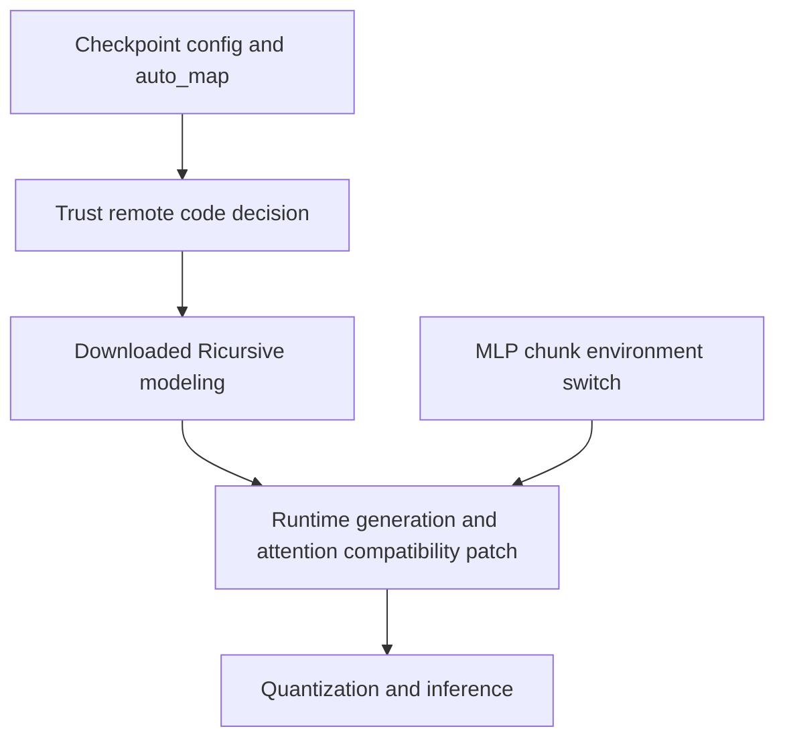
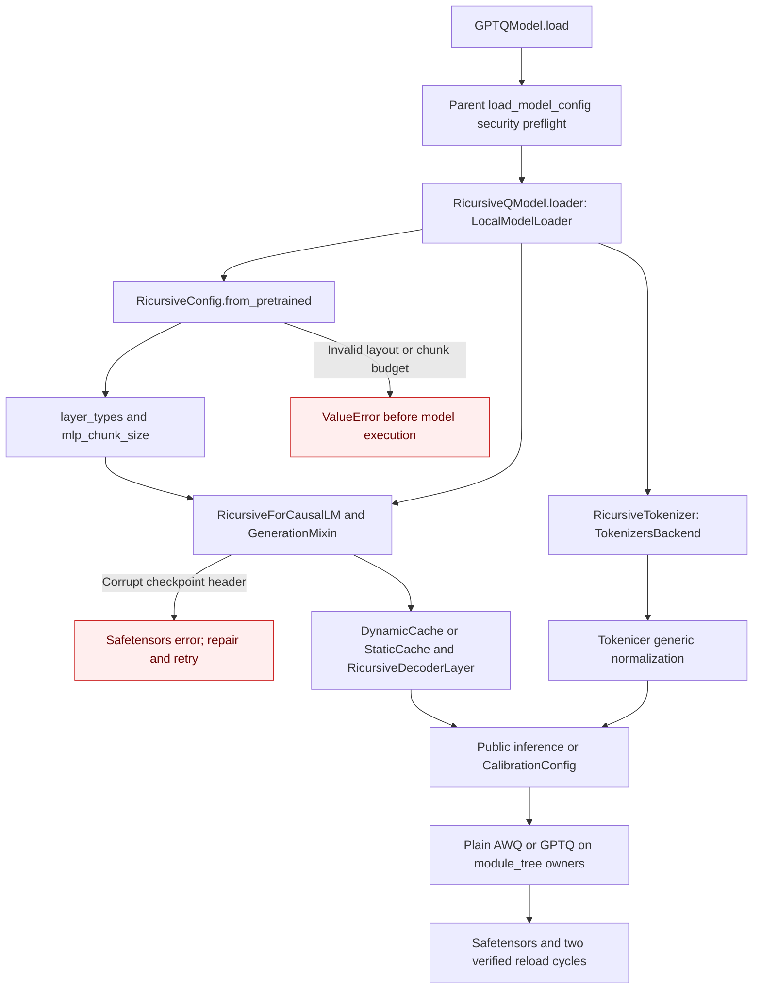

# Ricursive / Ripple Transformers 5 port

GPT-QModel directly owns configuration, modeling, generation preparation and
tokenizer selection for `model_type=ricursive`. Transformers 5.23.0 has no
native Ricursive config or causal-LM mapping. This is the actual Ripple
implementation, rather than a Llama architecture substitution.

## Provenance and checkpoint ownership

The port adapts the inspected Apache-2.0 code at
[`ricursiveAI/Ripple-65B-Preview@2f007aabfcedd0f8763d86d08f9aa0afbc344cea`](https://huggingface.co/ricursiveAI/Ripple-65B-Preview/tree/2f007aabfcedd0f8763d86d08f9aa0afbc344cea).
Its modeling/configuration SHA-256 values are respectively
`77161004d1a8d2493327e055c71e87de6ee560ed2ca255d6598bba266998ed9a` and
`002cb3915be9685eb962d617623bec14d45b5d6b5d46e689fac98a3b38cb6cf6`.
The original LICENSE is byte-preserved here; see NOTICE for attribution and
`fixtures/manifest.json` for all inspected source and fixture digests.

The complete headers of all 16 Preview shards and all 17 Base-Preview shards
were independently read, without fetching trained weights. Each release has
exactly 1,203 tensor names and shapes, all equal to the live meta model,
including the eight gated decoder projections, six decoder normalization
weights and the value-residual scalar per layer, plus embedding/final norm/head.
Base is pinned at `6187d1108a25fcc31681ec942ec3c581721b9fe1`; its source
modeling digest is recorded separately, not claimed identical to Preview.
Its older generation/cache/mask implementation predates the Preview compatibility
repairs; the tensor equations/layout are shared. Both pinned source digests
were reverified when inspecting that difference.

Both released serialized-BPE asset sets are included compressed and separately
hashed. They differ in raw bytes and EOS policy: Preview uses `<|im_end|>`
100265; Base uses `<|endoftext|>` 100257. Both pad with `<|pad|>` 100277.
Their BPE vocabulary/merges and the tested multilingual, whitespace, decode and
chat-format IDs agree. Definition-owned `TokenizersBackend` consumes each
release's data directly; outer Tokenicer normalization remains generic. No
port-specific corrective normalization is added. Neither pinned dense release
contains a `generation_config.json` (both URLs return 404); tests separately
exercise inherited config defaults and saved generation policies.

The published NVFP4 variant at `b4b4e36de43b5401f95c8e467cb3d1a355fd1e9f`
was inspected for configuration/source layout only. Its modelopt-packed tensor
payload and trained inference are unqualified; it is not removed from routing.

## Loading and execution flow

Before this change, `RicursiveQModel.require_trust_remote_code=True` and its
`after_model_load` hook selected and patched checkpoint Python. The port removes
that hook and trust requirement. The parent shared loader owns the security
preflight and Tokenicer integration.





| Previous owner/mechanism | Packaged behavior |
| --- | --- |
| Definition trust requirement (`ricursive.py:30` at base `bf4003d`) and checkpoint `auto_map` | `ricursive.py:RicursiveQModel.loader` selects only packaged config/model/tokenizer classes; trust and bypass cannot replace them. |
| Definition `after_model_load` runtime patch (`ricursive.py:72-76` at base) | Explicit `GenerationMixin` and native cache/generation preparation inside `modeling_ricursive.py`. |
| Upstream `RIPPLE_MLP_CHUNK` environment selection | `RicursiveConfig.mlp_chunk_size`, default 2048, zero disables row chunking; saved in config. |
| Native cache derives sliding storage even with no window | `get_text_config(decoder=True)` returns a copied full-storage view when `sliding_window=None`; decoder RoPE layout and caller config remain unchanged. |
| Static tree assumes every variant has `g_proj` | Definition effective-tree selection excludes the absent owner for ungated layouts. |
| Checkpoint-source test downloads | Ricursive-only helpers read trusted package files; isolated copies exist only where tests deliberately mutate classes for old-shim unit coverage. Independent raw-tensor oracles remain independent. |

## Preserved computation and quantization boundaries

Each layer keeps four PeriNorm operations, per-head Q/K RMSNorm, optional
sigmoid-gated attention, optional first-embedding/current-state value blending,
and source MLP clipping/embedding scaling. Sliding layers alone apply full-head
RoPE; full-attention layers have no positional rotation. MHA, GQA and MQA are
preserved. Native dynamic/full/hybrid/static caches handle multi-token decode,
sliding eviction, left padding and unwritten static capacity. The disabled-window
case keeps local-layer RoPE while selecting full cache storage.

All eight gated decoder projections (seven when ungated) are quantized. Norms,
value-residual scalars, embedding and LM head stay dense. `v_proj` has its own
input stage: its blended input cannot share the Q/K/gate Hessian. The sigmoid
gate is `nosrc`; no activation folding group is admitted. `awq_get_modules_for_scaling`
returns `[]` explicitly because blended values, sigmoid gates and clipped MLPs
cross scaling boundaries. Actual public plain-AWQ runs use `fallback=None`,
offload both false/true and exact packed/dense comparison across two reloads.
Fusion remains unqualified (`fusable=None`).

## Validation and reproducibility

Final qualification is performed on direct parent base
`bf4003dabad138a9245e55c87151d354a632bb97`, including main's
`CalibrationConfig`-only public quantization API. The original requested base
plus parent loader/tokenizer prerequisites was also tested before migrating;
those prerequisites are not Ricursive-owned commits.

Environment: Python 3.14.6 free-threaded / `PYTHON_GIL=0`, Transformers 5.23.0,
Torch 2.15.0 CPU, published Tokenicer 0.0.19 with no VCS `direct_url.json`.
The installed main Tokenicer source was independently byte-compared with its
SHA-verified PyPI sdist (`aa2ca0a70ec1103ccfa98090d9e195417a673206ae142b34ece555e6b1d19bef`).
The primary suite covers independent FP64/FP32/FP16/BF16 equations at positions
near 65,535; three KV layouts; hybrid/full/sliding layouts; gate/value toggles;
cache keys/values and continuations; greedy/beam generation and diagnostics;
assignment; failure/repair; actual released tokenizer assets; all trust/bypass
combinations; and real public quantization/save/reload. Migrated sibling suites
retain independent numerical, cache, GPTQ, loss and real CPU two-rank TP checks.

```bash
PYTHON_GIL=0 python -m pytest -q \
  tests/test_ricursive_local_port.py tests/module_tree/test_ricursive_local_port.py \
  tests/test_ricursive_support.py tests/test_ricursive_modeling_numerics.py \
  tests/test_ricursive_native_generation.py tests/test_ricursive_modeling_contracts.py \
  tests/test_ricursive_modeling_precision.py tests/test_ricursive_review_regressions.py
PATH=/home/ubuntu/.venvs/gptqmodel-tf5/bin:$PATH format/check.sh
git diff --check
```

The final combined run completed in 83.53 seconds:

| Family | Passed | Skipped / deselected |
| --- | ---: | --- |
| New port/model-owner suites | 132 | 0 |
| All Ricursive suites, including the migrated siblings | 454 | 22 CUDA cases |
| Required AWQ and registry/order baseline | 574 | 3 absent DeciLM/Exaone/Nanbeige checkpoints |
| Shared loader/path/tokenizer/security | 116 | 1 known shared stale-API case deselected |
| Fusion admission | 101 | 460 NVIDIA Marlin cases |
| Combined (the 132 new cases are included in the 454) | 1,245 | 485 skipped, 1 deselected |

The shared `test_quantized_reload_retains_once_normalized_wrapper` was actually
run and fails because it still passes a raw dataset and removed `batch_size` /
`calibration_data_min_length` keywords to `quantize`. That parent-owned test
needs `CalibrationConfig`; it is the only deselection above. No shared test or
algorithm was changed here. All six real public plain-AWQ cases use the current
API, reach decoder input capture, pack every declared linear, preserve every
dense owner, generate, and compare every tensor after two saves/reloads.

The full combined reproduction adds this baseline to the owned command above:

```bash
owned=(
  tests/test_ricursive_local_port.py tests/module_tree/test_ricursive_local_port.py
  tests/test_ricursive_support.py tests/test_ricursive_modeling_numerics.py
  tests/test_ricursive_native_generation.py tests/test_ricursive_modeling_contracts.py
  tests/test_ricursive_modeling_precision.py tests/test_ricursive_review_regressions.py
)
baseline=(
  tests/test_awq_scale_search_safety.py tests/test_awq_moe_router_scaling.py
  tests/test_awq_empty_groups.py tests/test_awq_position_kwargs.py
  tests/test_awq_scale_search_memory.py tests/test_bloom_awq_replay.py
  tests/module_tree/test_awq_relationships.py tests/module_tree/test_bloom_awq_relationships.py
  tests/module_tree/test_registered_module_plans.py tests/module_tree/test_definition_subset_ordering.py
  tests/module_tree/test_fusable_models.py tests/test_local_model_loading.py
  tests/test_local_model_paths.py tests/test_local_tokenizer_loading.py
  tests/test_trust_remote_code_isolation.py
)
PYTHON_GIL=0 python -m pytest -q "${owned[@]}" "${baseline[@]}" \
  -k 'not test_quantized_reload_retains_once_normalized_wrapper'
```

Process-only negative probes were removed before the green run:

| Injected defect | Observable red result | Unmodified/control result |
| --- | --- | --- |
| Omit post-attention PeriNorm | All 72 raw-equation cases fail | All 72 pass |
| Ignore blended input at `v_proj` | 36 failures across all four dtypes/KV layouts | All 36 no-value-residual controls pass |
| Remove owned tokenizer binding | Base whitespace IDs become `[220,264,197,65,271,272]` rather than `[220,264,2282,271,272]` | Preview control passes; all 12 owned trust/bypass/release cases pass |

The oracle performs its own interpolation, Q/K/V projections, RMS/rotary,
masking, softmax, value mixing, MLP and head arithmetic. It uses FP32
intermediates for low-precision interpolation/attention, preserving source
RMS/rotary casts. In the 72-case matrix, maximum valid-token full-decoder
absolute errors were 0 (FP64), `2.20e-7` (FP32), `7.94e-4` (FP16), and
`6.60e-3` (BF16). Fixed `atol=rtol` bounds are `2e-5`, `2e-5`, `1.2e-3`, and
`8e-3`, respectively; BF16 accumulates backend rounding across the complete
decoder. This does not qualify a new optimized inference kernel. Packed and
dense checkpoint comparisons, sampled/greedy token IDs and quantized reload
logits remain exact. Ruff 0.14.2, compileall, package discovery, fixture hashes,
the byte-preserved license and `git diff --check` also pass. Existing
`MANIFEST.in` includes the port's LICENSE/NOTICE/JSON/gzip data.

## Limits

No trained 65B payload or quality evaluation, GPU/ROCm/FlashAttention/fused
kernels, multi-GPU, general threaded Torch execution, compilation, training
support, speculative decoder, quantized/offloaded/foreign cache, or advertised
two-million-token context qualification is claimed. CPU two-rank FP32 TP and
tiny loss/gradient regressions are bounded tests, not broad distributed or
training qualification. Header/meta equivalence does not establish trained
NVFP4/modelopt payload support. The old compatibility utility remains outside
the public Ricursive loading path and is exercised only by explicit isolated
shim tests; no production port code reads its environment switch.

Parent integration owns central docs/main README/PR diagrams, package-data
inclusion, the unchanged default registered plan and these central updates:

```json
{
  "fusable_models.models.ricursive.reason": "Package-owned Ricursive hybrid sliding/full attention with value residuals, gated attention and PeriNorm; fusion executor has not been qualified."
}
```

No generic AWQ family-set edit is needed: `ricursive` is absent from those
families at the qualified base. The owned public tests qualify its plain path.
