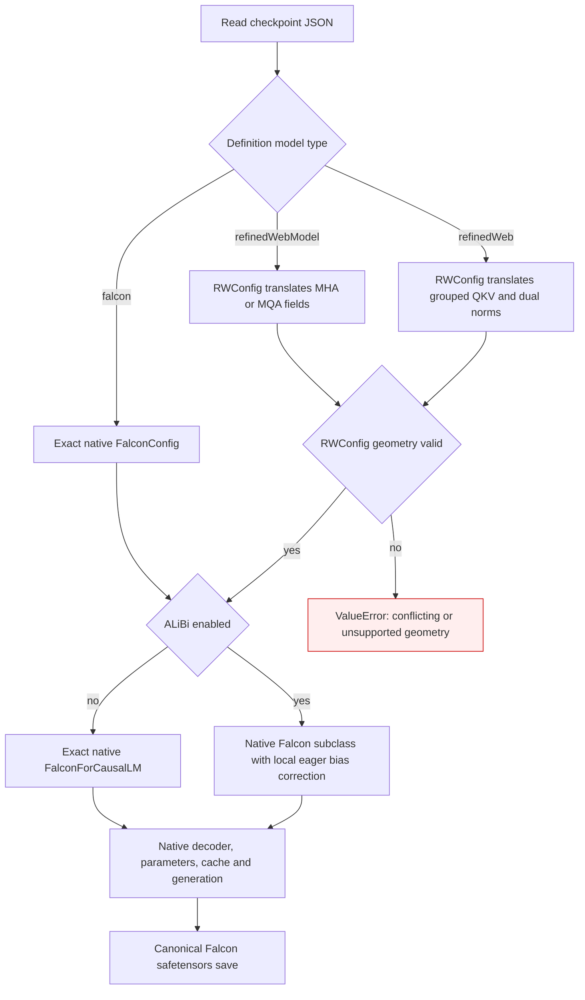
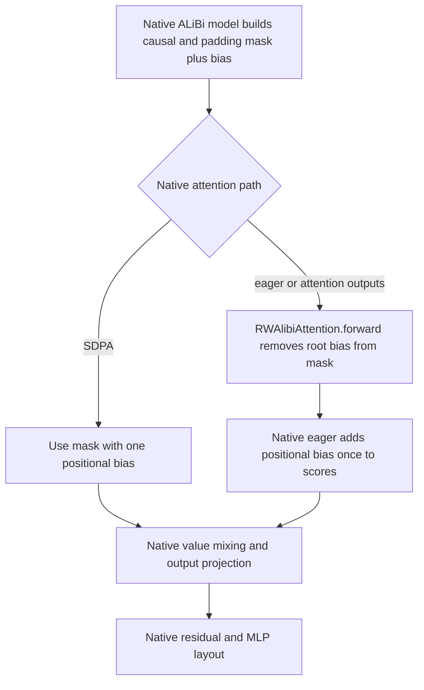

<!-- SPDX-FileCopyrightText: 2026 ModelCloud.ai -->
<!-- SPDX-License-Identifier: Apache-2.0 -->

# Native Falcon and historical RW aliases

GPT-QModel owns config/model selection for `falcon`, `refinedWeb` and
`refinedWebModel` (case insensitive). Canonical Falcon retains the exact
Transformers `FalconConfig`; RoPE models retain the exact native
`FalconForCausalLM`. Historical aliases translate config fields into Falcon,
then save canonical `model_type: falcon` metadata. No old modeling implementation
is copied, no global HF registration occurs, and checkpoint `auto_map` cannot
replace the definition's local loader, even with explicit trust and bypass.

## Inspected releases and provenance

| Release | Canonical config/checkpoint/tokenizer revision | Historical config and Apache source/relicensing revision | Computation and ownership |
| --- | --- | --- | --- |
| [Falcon-RW-1B](https://huggingface.co/tiiuae/falcon-rw-1b) | `e4b9872bb803165eb22f0a867d4e6a64d34fce19` | `7edc4471c20877af32d33d93b3b9926a3016d201` | Sequential MHA, ALiBi, biased projections, input/post-attention norms; source geometry instantiated on meta, no released weight inventory |
| [Falcon-7B-Instruct](https://huggingface.co/tiiuae/falcon-7b-instruct) | `8782b5c5d8c9290412416618f36a133653e85285` | `22225c3ac76bdddc1c6c44ebea0e3109468de29f` | Parallel MQA, RoPE, one shared input norm; all 196 actual safetensors header keys/shapes match meta |
| [Falcon-40B-Instruct](https://huggingface.co/tiiuae/falcon-40b-instruct) | `ecb78d97ac356d098e79f0db222c9ce7c5d9ee5f` | `5b9409410d251ab8e06c48078721c8e2b71fa8a1` | Grouped QKV with eight KV heads, dual `ln_attn`/`ln_mlp`; all 484 actual legacy checkpoint-index keys match meta |

`source_sha256.json` pins both historical and canonical configs, source, README, tokenizer asset,
and header/index digest. `checkpoint_inventory.json` contains those real
configs and only observed key/shape metadata, with no trained tensor payload.
Every historical config's meta geometry is also checked against the actual
canonical in-library config from the newer checkpoint revision. Historical
config JSON comes from the source/relicensing revision, rather than being
mistakenly labeled as a newer canonical release's config.
The legacy bin *index JSON* is parsed; pickle payloads are never read.
All three pinned README revisions explicitly remove the original TII royalty
license and identify the release as Apache-2.0. `LICENSE` and `NOTICE` retain
native Transformers/Falcon and TII/BigScience attribution. Pre-relicensing
sources were cross-checked; the 7B post-relicensing change passes the compute
dtype to its existing rotary cache helper. This adapter implements the source
equations with current native cache/rotary APIs, rather than retaining old bugs
in that helper or remote-code compatibility shims.

The native reference is **Transformers 5.23.0**,
`transformers/models/falcon/modeling_falcon.py` SHA-256:
`a2864630f1d1793a09e70b615c2f8c04b8ef6c08fbbafefb0538ade916e666b1`.
The numerical regression must be rerun when changing this dependency; a future
native ALiBi repair may make the narrow override unnecessary.

## Selection and computation



`n_layer`, `n_head`, `n_head_kv` and `n_embed` translate to their native fields.
Conflicting old/new values and unqualified decoder/norm/KV/MLP geometry fail
closed. Explicit one-KV or legacy all-head metadata is allowed for MQA;
intermediate grouped layouts require `refinedWeb`. Historical defaults follow
the inspected RW config (64 hidden, eight heads, two layers, 250880 vocabulary,
no multi-query, sequential attention). Published release configs explicitly
select their larger geometry and parallel/MQA policies.

In native 5.23.0, `FalconModel.forward` adds scaled ALiBi to the additive mask
for SDPA, while eager `FalconAttention.forward` independently adds the same
bias to its scores. That produces `(QK + 2*ALiBi)/sqrt(d)` under eager instead
of source `(QK + ALiBi)/sqrt(d)`. `RWAlibiAttention` subtracts only the root's
already-inserted bias before delegating to native eager attention. SDPA keeps
its native path; `output_attentions=True` correctly receives the eager repair.
The original initialized/meta projection modules and parameter names are
retained. Native FlashAttention classes retain their own dispatch/checks and
are unqualified here. No process-global class or function is changed.



| Boundary | Before | After |
| --- | --- | --- |
| Legacy config | Unknown AutoConfig type or checkpoint Python | Definition-owned field translation and exact native geometry |
| Native RoPE | Native Falcon | Exact same native model/config class for canonical Falcon |
| ALiBi eager | Native positional bias applied twice | Narrow family override restores source equation |
| Decoder norms | RW plan declared nonexistent `ln_1`/`ln_2`; Falcon plan omitted dual norms | Actual sequential, shared and dual-norm owners declared |
| Shared input tags | Unconditional parallel tag | `in=x` only when QKV and MLP actually read the same tensor |
| AWQ | Generic inferred scale groups | Explicit plain quantization; no source/consumer fold or scale search claim |

## AWQ policy and parent integration

Both definitions deliberately return no AWQ scaling groups. Sequential
attention has a residual boundary before the MLP, single-norm parallel
attention has two sibling consumers, and dual-norm parallel attention has two
distinct sources. Source/consumer replay and folds are not qualified for these
layouts. GELU also prevents the MLP input projection from being a source for
the output projection (`nosrc`). Empty groups use the existing plain AWQ
quantizer with **`fallback=None`**; all four projections in each decoder layer
still calibrate, quantize and pack. No shared algorithm changes are needed.

`central_fixture_proposals.json` contains the exact parent-owned updates:

- Replace `RwgQModel/gptq` and `FalconQModel/gptq` with the explicit eight-block
  norm/projection plan. Registered alias mappings stay unchanged.
- Add `falcon` to `tests/test_awq_scaling_groups.py`'s
  `PLAIN_QUANTIZATION_FAMILIES`.
- Update `falcon`, `refinedWeb` and `refinedWebModel` fusion exclusion reasons.
  Fusion admission remains disabled.

These central files are not edited on this branch. Parent integration also
owns central coverage/README/PR diagrams and package-data inclusion for this
directory's LICENSE, NOTICE, and runtime JSON. The package is discovered
by setuptools without editing a shared initializer or dependency file.

## Reproduction and evidence

Final qualification uses direct parent **`bf4003dabad138a9245e55c87151d354a632bb97`**,
including the newly merged **CalibrationConfig-only** public API. It uses
Python 3.14.6t with `PYTHON_GIL=0`, Torch 2.15.0+cpu, Transformers 5.23.0, and
published Tokenicer 0.0.19 (distribution metadata audited, no VCS direct URL).
An earlier 112-case run was green on 22bea1201 plus parent security prerequisite
5423ad629, using Tokenicer 0.0.14 and the then-current API. That prerequisite
copy and the old branch are **not** part of the final integration commits.

```bash
PYTHON_GIL=0 /home/ubuntu/.venvs/gptqmodel-tf5/bin/python -m pytest -q \
  tests/test_rw_local_port.py tests/module_tree/test_rw_local_port.py
PATH=/home/ubuntu/.venvs/gptqmodel-tf5/bin:$PATH format/check.sh
git diff --check
```

Owned coverage includes independent FP64 scalar-head packed-QKV, rotary,
ALiBi, attention, GELU, residual/norm and logits equations; MHA/MQA/GQA with
and without biases; FP32/FP16/BF16 and eager/SDPA; distinct left padding;
1+4+1+1 cache continuation; greedy/three-beam generation; two exact dense
safetensors reloads; config/subfolder and corrupted-safetensors failure,
repair and retry; and strict state assignment with both assign policies.
ALiBi tests use four and six heads, validate actual probability outputs,
and cover `output_attentions` under both backends. Shared-input tags are
checked against hooks on real QKV and MLP inputs, with nonidentical dual norms.

The 42 hostile public loads cover seven canonical/legacy layout bindings,
API trust false/true and bypass absent/0/1. All forward/generate and tokenizer
checks execute with malicious config/model `auto_map` sentinels untouched.
Twelve real public AWQ cases cover all three layouts under canonical/legacy
metadata and offload false/true, use `CalibrationConfig(dataset=...,
batch_size=1,min_length=1,sort="desc",concat_size=None)`, pack every one of
eight decoder projections, preserve excluded dense tensors/biases, and perform
two exact packed+dense safetensors save/reload/inference cycles per case.

The CI-sized tokenizer fixture is explicitly synthetic. Separately, all three
real pinned tokenizer asset sets were tested offline through the public
`load_hf_tokenizer`/Tokenicer route against independently loaded serialized
Rust tokenizer data: 24 Latin/CJK/whitespace/special-token ID/decode cases plus
native save/reload, covering actual historical and canonical model configs
(7B/40B EOS and pad 11; RW-1B EOS and pad 50256). Their exact SHA digests are in the source manifest; no
tokenizer normalization shim is added here.

Red/green evidence:

- Original alias and real norm-owner tests: eight intended failures, two
  controls passed; initial repair: ten passed.
- Independent raw native ALiBi eager oracle: 512/640 wrong logits, maximum
  absolute error 0.0057161885; native SDPA control passed.
- Removing only the owned bias repair in a disposable test process: seven
  intended ALiBi failures, three SDPA controls passed (0.24s), including
  padding, six heads and attention-output fallback. Checked-out source and
  native classes remain unchanged.
- Final owned: **136 passed, zero skips** (13.46s); metadata audit additionally
  reran all 18 module-plan/meta cases (2.54s), including independently fetched
  historical and current configs. Full combined: **926 passed, eight existing
  skips**, with the proposed central data applied in memory. There are no
  deselections or expected failures in the combined run.
- Full `format/check.sh` passes with Ruff 0.14.2; port Pyright has zero errors
  or warnings. Compileall, diff checks, exact-revision live asset SHA audits,
  live range-only header verification for both 7B shards, byte-identical
  Apache license verification and setuptools package discovery pass.

For the required shared AWQ/registry baseline, apply the proposed registry
cases and plain-family addition **in memory** during pytest collection (or
apply them centrally during integration); an unchanged central fixture is
expected to reject the new definition plan. The baseline consists of
`test_awq_scale_search_safety`, `test_awq_moe_router_scaling`,
`test_awq_empty_groups`, `test_awq_position_kwargs`,
`test_awq_scale_search_memory`, `test_bloom_awq_replay`,
`module_tree/test_awq_relationships`, `module_tree/test_bloom_awq_relationships`,
`module_tree/test_registered_module_plans`,
`module_tree/test_definition_subset_ordering`, plus local-loader and scaling
group suites. Its eight unrelated skips are three absent remote fixtures
(DeciLM/Exaone/Nanbeige), three absent PanGu cases, and nonbuildable opt350 and
muse_glimmer CausalLM fixtures. No owned case is skipped.

Exact combined-baseline invocation from the repository root (the collection
hook applies only the two owned integration proposals to module globals):

```bash
PYTHON_GIL=0 PYTHONPATH=tests:tests/module_tree /home/ubuntu/.venvs/gptqmodel-tf5/bin/python - <<'PY'
import json
from pathlib import Path
import pytest

proposal = json.loads(Path("gptqmodel/models/ports/rw/central_fixture_proposals.json").read_text())

class OwnedFixtureProposal:
    def pytest_collection_modifyitems(self, items):
        for item in items:
            values = getattr(getattr(item, "obj", None), "__globals__", {})
            inventory = values.get("INVENTORY")
            if isinstance(inventory, dict) and "cases" in inventory:
                inventory["cases"].update(proposal["registered_module_plans"]["cases"])
            families = values.get("PLAIN_QUANTIZATION_FAMILIES")
            if isinstance(families, set):
                families.update(proposal["test_awq_scaling_groups"]["PLAIN_QUANTIZATION_FAMILIES_add"])

paths = [
    "tests/test_rw_local_port.py", "tests/module_tree/test_rw_local_port.py",
    "tests/test_local_model_loading.py", "tests/test_awq_scale_search_safety.py",
    "tests/test_awq_moe_router_scaling.py", "tests/test_awq_empty_groups.py",
    "tests/test_awq_position_kwargs.py", "tests/test_awq_scale_search_memory.py",
    "tests/test_bloom_awq_replay.py", "tests/module_tree/test_awq_relationships.py",
    "tests/module_tree/test_bloom_awq_relationships.py",
    "tests/module_tree/test_registered_module_plans.py",
    "tests/module_tree/test_definition_subset_ordering.py", "tests/test_awq_scaling_groups.py",
]
raise SystemExit(pytest.main(["-q", "--tb=short", *paths], plugins=[OwnedFixtureProposal()]))
PY
```

## Limits

No trained payload/quality, GPU, FlashAttention/optimized kernel, multi-GPU,
threaded PyTorch execution, compile, training, extended-context, foreign or
static/offloaded/quantized KV cache, AWQ fold/search, or fusion qualification is
claimed. GIL-disabled sequential CPU tests do not prove concurrency safety.
RW-1B checkpoint weights are only available in legacy bin form and were not
downloaded; its actual released tensor inventory remains unverified.
Falcon-180B-chat config access returned HTTP 401, so no 180B layout is claimed.
The existing trained CUDA evaluation test was retained but not executed
(its `/monster/data/model/falcon-7b-instruct` fixture is unavailable).
