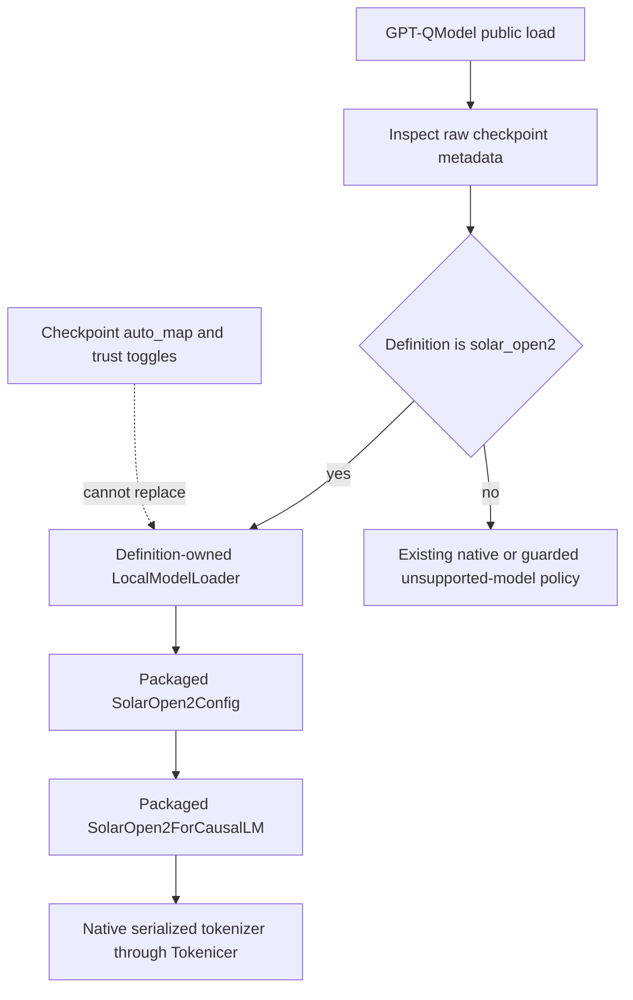
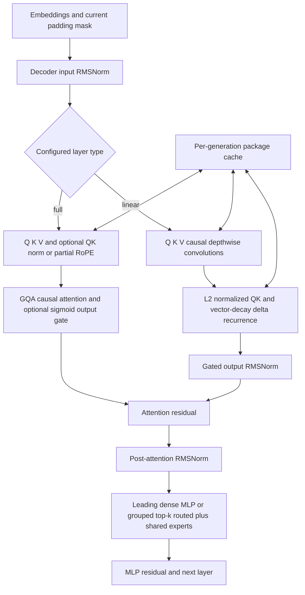

# Solar-Open2 — package-owned Transformers 5 port

## Ownership and provenance

Transformers **5.23.0** maps `solar_open` but has neither a `solar_open2`
configuration nor an AutoModelForCausalLM implementation. Solar Open 1 is not
a substitute. The released [Solar-Open2 model card](https://huggingface.co/upstage/Solar-Open2-250B/blob/9190fbe63a2ad8e17fc766ccceb36de7c66f004b/README.md)
points to [Upstage's Transformers fork](https://github.com/upstageAI/transformers/tree/ef5c37485091057070b36dd0620798f74988eb01/src/transformers/models/solar_open2).
This port derives from that inspected configuration, modeling and modular
source at **ef5c37485091057070b36dd0620798f74988eb01**, not checkpoint Python.
The release is pinned at **9190fbe63a2ad8e17fc766ccceb36de7c66f004b**.

`source_manifest.json` pins source/assets/license SHA-256 values. The source
files carry Apache-2.0 notices, retained in the port; `LICENSE` preserves the
fork's license. Released artifacts have the separate **Upstage Solar License**
in `SOLAR_LICENSE`, including derivative-model branding conditions. Do not
describe the model artifacts as Apache-only. See `NOTICE` for modifications.

All **47,019** tensor keys and shapes from **94** released safetensors headers
equal a real package-model meta state dict, including 48 decoder blocks,
12 full GQA layers, 36 KDA layers, 320 routed experts and the shared experts.
`released_shapes.json` is the full header-derived shape/dtype inventory;
`header_manifest.json` pins each header. No trained tensor payload is included.
Header acquisition used HTTP Range `bytes=0-7` for the little-endian uint64
header length, then `bytes=8-(7+length)` for JSON, verified status 206 and
exact byte count, and checked every key against the pinned checkpoint index.

## Before and after

| Boundary | Before | After |
| --- | --- | --- |
| Config/model | Exact native mapping absent; tiny tests skipped | Definition binds package classes directly |
| Checkpoint Python | Could be selected through remote metadata | Hostile model/config maps never execute, with either trust value and every bypass state |
| Hybrid attention | Replay metadata was not a modeling implementation | Source-matched GQA and vector-decay KDA with convolution/recurrent cache |
| Expert ownership | Native fork expects fused expert representation | Released per-expert `ModuleList` keys are exact, without checkpoint conversion |
| Cache | Older fork API cannot provide current hybrid state | Current native state slots plus per-cache sequence accounting, reset and beam reordering |
| AWQ | No qualified source/consumer guarantee | Explicit plain quantization; no folds or scale search |
| Fusion | Not qualified | Explicitly unqualified, `fusable = None` |





## Qualified behavior

Tests use real tiny modules, not mocked layouts. Independent float64 equations
cover the full decoder, grouped MoE routing/shared contribution, attention,
causal convolution, vector KDA decay/update and final recurrent state. The
RoPE oracle deliberately reproduces source FP32 position/frequency rounding
before computing in float64, including positions near 65,535; this is not a
long-context quality claim. A mutation replacing vector decay with head-mean
scalar decay produces **12 intended failures** in the independent decoder
oracle (0.52s), rather than passing on self-comparison.

CPU/meta owner tests cover MHA/GQA/MQA, optional attention/gate biases, QK
norms, full/factored KDA projections and leading dense layers. Runtime tests
cover both hybrid orders, full-only/KDA-only layouts, optional shared experts,
negative-eigenvalue beta/clipped decay policies, partial/no RoPE, gated/ungated
GQA, eager/SDPA, FP32/FP16/BF16, causal future perturbations, 1+4+1 cache
continuation, left padding, independent interleaved caches, reset, greedy and
beam generation, tuple/hidden/attention outputs, strict buffer ownership,
assignment, corrupt-safetensors failure/repair/retry and two dense save cycles.
Attention weights are requested with eager attention, not unsupported SDPA.

The six public hostile-layout cases cover trust False/True crossed with bypass
unset/`0`/`1`, actual public dense load/generation and two native safetensors
saves/public reloads. Neither checkpoint modeling Python nor checkpoint
`custom_generate` runs. An additional six direct config/shell cases cover the
same security matrix. There is no remote modeling fallback for this definition.

**AWQ is plain quantization only**, not folding/search qualification. Six real
public load/quantize/pack/infer tests cross full/factored KDA plus dense/MoE
layouts with disk offload False/True and `fallback=None`. They assert all
39/40/27 expected decoder linears pack, all excluded dense tensors survive,
and every packed/dense tensor and logits survive **two** safetensors saves and
reloads. Gate/decay low-rank projections, convolutions, norm, router and
correction-buffer owners are explicitly excluded. Nonrepresentable FP32 router
bias values catch loss hidden by zero-valued fixtures: the old shared reload
path gives six intended failures (7.61s); canonical parent FP32 policies repair
them without a port shim. Narrow rank-8 projections use the existing supported
per-module group-size fallback, not a new quantizer algorithm.

Real pinned tokenizer data was separately checked offline: raw Rust backend,
native AutoTokenizer and the public tokenizer helper agree on multilingual,
whitespace and special-token IDs/decode, chat-template encoding, and two
save/reload cycles using published **Tokenicer 0.0.19**. `tokenizer_oracle.json`
records those exact observations and `source_manifest.json` pins all four real
assets. The 16MB tokenizer is not bundled. This manual asset check is distinct
from the small synthetic tokenizer used by network-free model/AWQ unit tests;
no tokenizer normalization shim was added.

## Reproduction and integration

Initial qualification started at the requested `22bea120181e739161ee2969b260fe94f5b4e791`
with canonical shared loader/FP32 prerequisite copies only. The initial final
owned run was **107 passed**, one trained-checkpoint test explicitly deselected
(25.87s). After the parent integrated main, the port was cleanly applied to
**bf4003dabad138a9245e55c87151d354a632bb97** and its AWQ tests migrated to the
current `CalibrationConfig(dataset=..., batch_size=1, min_length=1)` API,
retaining `backend` as a public non-calibration argument. No old-API shim.

Environment: Python **3.14.6t**, `PYTHON_GIL=0`, Torch **2.15.0+cpu**,
Transformers **5.23.0**, published Tokenicer **0.0.19** (not a VCS build).

From the repo root, with the isolated environment on PATH:

```sh
export PATH=/home/ubuntu/.venvs/gptqmodel-tf5/bin:$PATH
PYTHON_GIL=0 python -m pytest -q --tb=short \
  tests/test_solar_open2_local_port.py \
  tests/module_tree/test_solar_open2_local_port.py \
  tests/models/test_solar_open2.py -k 'not TestSolarOpen2'
bash format/check.sh
python -m compileall -q gptqmodel/models/ports/solar_open2 \
  gptqmodel/models/definitions/solar_open2.py tests/test_solar_open2_local_port.py \
  tests/module_tree/test_solar_open2_local_port.py tests/models/test_solar_open2.py
git diff --check
```

Current-base owned result: **108 passed, 1 deselected in 32.27s**. The one
deselected test is the existing trained 250B checkpoint evaluation, not a tiny
model skip. Pyright with `--pythonpath` pointing to the isolated environment
was run on the port, **50 errors, 0 warnings**: inherited Transformers
typing/protocol and optional-state
diagnostics remain; this is explicitly **not** a clean static-type claim.

Current-base combined owned/required AWQ/loader/security/registry/fusion run:
**894 passed, 463 skipped, 3 deselected in 42.55s** (15 warnings).
Skips are 460 NVIDIA-only Marlin cases and three unavailable local checkpoint
fixtures (DeciLM, Exaone, Nanbeige). Besides the trained Solar test, two existing
InternLM AWQ tests were deselected **only after actually running and failing**
on removed legacy `batch_size`/`calibration_data_min_length` public kwargs;
their CalibrationConfig migration is parent-owned, not changed here. All six
Solar public AWQ cases run with the new API, not deselected. The first
unfiltered current-base shared run needed the missing SentencePiece 0.2.3
dependency installed; the next isolated failures were only those two stale
InternLM tests. No failure was changed into a skip inside repository tests.

The exact combined command applies only the two proposed central JSON updates
in process memory (no shared fixture edit):

```sh
PYTHON_GIL=0 python - <<'PY'
import json
from pathlib import Path
import pytest
from tests.module_tree import test_registered_module_plans as registry
from tests.module_tree import test_fusable_models as fusion
p = json.loads(Path('gptqmodel/models/ports/solar_open2/central_fixture_proposals.json').read_text())
registry.INVENTORY['cases']['SolarOpen2QModel/gptq'] = p['registered_module_plans.cases.SolarOpen2QModel/gptq']
fusion.INVENTORY['solar_open2'].update(p['fusable_models.models.solar_open2'])
files = '''
tests/test_solar_open2_local_port.py
tests/module_tree/test_solar_open2_local_port.py
tests/models/test_solar_open2.py
tests/test_local_model_loading.py
tests/test_trust_remote_code_isolation.py
tests/test_local_model_paths.py
tests/test_internlm_local_port.py
tests/test_awq_scale_search_safety.py
tests/test_awq_moe_router_scaling.py
tests/test_awq_empty_groups.py
tests/test_awq_position_kwargs.py
tests/test_awq_scale_search_memory.py
tests/test_bloom_awq_replay.py
tests/module_tree/test_awq_relationships.py
tests/module_tree/test_bloom_awq_relationships.py
tests/module_tree/test_registered_module_plans.py
tests/module_tree/test_definition_subset_ordering.py
tests/module_tree/test_fusable_models.py
'''.split()
raise SystemExit(pytest.main(['-q', '--tb=short', '-rs', '-k',
    'not TestSolarOpen2 and not test_internlm_plain_awq_quantizes_every_linear_and_reloads', *files]))
PY
```

`format/check.sh` and explicit owned `ruff format --check` pass with pinned
Ruff 0.14.2. Compileall, setuptools package discovery, source/legal-asset SHA
checks and `git diff --check` pass. The narrow `.gitattributes` rule preserves
the upstream license's original Markdown hard-break spaces byte-for-byte.

Parent/integrator owns the two exact JSON proposals in
`central_fixture_proposals.json`: replace the entire SolarOpen2 registered
plan case (excluded KDA tensors/router bias added), and replace the unqualified
fusion reason. The generic AWQ `FAMILIES` set does not include `solar_open2`,
so no generic `PLAIN_QUANTIZATION_FAMILIES` edit is needed. Shared fixtures are
not edited by this port; integration checks can apply these proposals in memory.
Parent owns central coverage/README/PR diagrams. Existing `MANIFEST.in` patterns
include the port's licenses, notice and runtime JSON; setuptools discovers it.

## Limits

No trained 250B payload inference, model quality, million-token context,
GPU/FlashAttention/FLA/fused kernels, multi-GPU or whole-model offload,
concurrent Torch execution, compile, training, speculative decoding, foreign,
static/quantized/offloaded cache, fusion or AWQ scale-search/folding claim.
Only ordinary Torch eager recurrence is implemented for KDA. Recurrent-state
rollback/crop and foreign cache types fail explicitly rather than corrupting
state. Hyper-Connections are rejected, matching the inspected source's boundary.
Native tokenizer parity is not evidence of trained-model generation quality.
