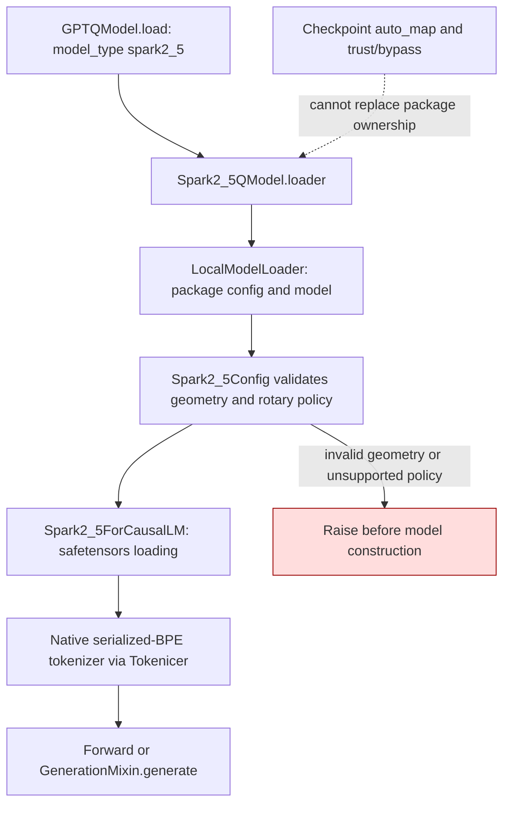
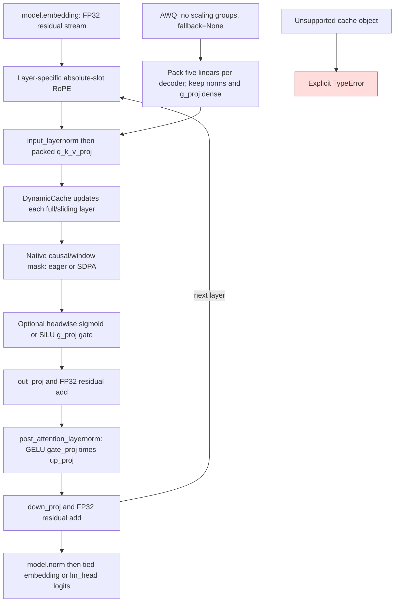

# Spark2.5 package ownership and execution

GPT-QModel loads `spark2_5` through `Spark2_5QModel.loader`, an explicit
`LocalModelLoader` for `Spark2_5Config` and `Spark2_5ForCausalLM`. Transformers
5.23.0 has no `spark2_5` config or causal-LM mapping. The implementation is
adapted from [XHToken/Spark-X2.5-4B](https://huggingface.co/XHToken/Spark-X2.5-4B/tree/0bcb35678590218655dff3765b9e61c83b35e9c4),
pinned at `0bcb35678590218655dff3765b9e61c83b35e9c4`. Apache-2.0 LICENSE and
NOTICE accompany the port; `fixtures/source_sha256.json` records inspected
source, config, policy, tokenizer, index and header-export hashes.

The published release has 36 layers, hidden width 2560, 16 query heads,
4 KV heads, head width 256, GELU-gated MLP width 10240 and tied embeddings.
The full/sliding schedule is taken from config. Full attention uses partial
RoPE (factor 0.25, theta 5000000); sliding attention uses full RoPE (theta
10000) with a 512-token window. All 290 published tensor names and shapes
across five safetensors headers agree exactly with a meta instance. The tied
`lm_head.weight` alias exists in memory and is omitted in the released index.
Header-export hashes do not assert full shard integrity or trained values.
The local `.gitattributes` preserves one upstream generation-policy trailing
space so its pinned source bytes and SHA remain exact.





| Previous mechanism | Package-owned replacement |
| --- | --- |
| Definition `loader` inherited remote-capable AutoModelForCausalLM | Explicit lazy `LocalModelLoader`; no global HF registration |
| Definition `before_model_load` imported checkpoint class and rewrote mask helpers | Current `create_causal_mask` / `create_sliding_window_causal_mask` API directly |
| Definition `after_model_load` installed a fake dense `.weight` on packed MLPs | Decoder reads packed compute metadata or dense projection dtype, with norm dtype only a fallback |
| Checkpoint modeling imports and global norm registration | Package-relative modeling/config imports; no global layernorm registry mutation |
| Implicit AWQ source/consumer inference | Explicit empty scaling groups; real plain quantization with `fallback=None` |

## Contracts and qualification

Checkpoint keys and equations retain packed **Q/K/V** slices, optional per-head
output gates, configurable attention/MLP biases, MHA/GQA/MQA, per-layer RoPE,
FP32 residual additions, source GELU and tied/untied heads. RoPE follows source
absolute cache slots, including when per-row `position_ids` are supplied.
Native `DynamicCache` handles full and sliding layers; unrelated cache formats
raise explicitly. Only eager and SDPA are qualified. No kernel dependency is
downloaded or imported dynamically by this package.

Tests use nondegenerate weights and independent float64 attention/MLP equations
(including left padding), hidden/head width mismatches, released-width 256
RoPE near slot 1048570, CPU/meta module owners, three dtypes, all-full,
all-sliding and hybrid layouts. Cached chunks 1+4+1+1 cross the sliding boundary;
greedy/beam generation agrees with uncached execution. Root generation policy,
actual EOS stopping, seeded sampling scores/tokens, caller policy, explicit
overrides and policy immutability survive two save/reload cycles.

Six public hostile-load cases cover trust false/true times bypass absent/0/1,
with model, tokenizer and custom-generation Python sentinels. Exact pinned
Rust-BPE IDs, Unicode/whitespace/special-token decoding and Jinja prompt text
roundtrip through released Tokenicer 0.0.19. No tokenizer normalization shim is
present. Synthetic tiny vocabularies are used only where vocabulary semantics
are irrelevant to quantization mechanics.

Six actual public AWQ cases use `CalibrationConfig(dataset=..., batch_size=1,
min_length=1, sort="desc")`, `fallback=None`, offload false/true and gate/bias/KV
variants. All ten physical decoder linears pack; every excluded norm, embedding
and optional head gate remains exact. Two safetensors saves/reloads preserve
every packed and dense tensor and inference logits. Packed linears acquire no
dummy dense `.weight`. AWQ scaling/search/folding and fusion remain unqualified.

Injected process-local defects establish detection (no runtime files modified):

| Defect | Intended red result |
| --- | --- |
| Swap packed K/V outputs | 18 source-oracle failures, 0.46s; one case differs at all 512 checked elements |
| Replace partial RoPE with full-head RoPE | 1 boundary-oracle failure, 0.13s; 128/192 elements differ, max absolute error 0.12473 |
| Downcast each residual output | 2 FP16/BF16 residual contract failures, 0.14s |
| Restore source `mlp.gate_proj.weight.dtype` read | All 6 actual public AWQ cases fail on absent packed `.weight`, 1.53s |
| Select low-precision projection input dtype from FP32 norm weights | 2 real FP16/BF16 mixed-norm failures, 2.53s; repaired by projection-owned compute metadata |

Final owned suite: **130 passed, zero skips, 31.46s**, on Python 3.14.6t
with `PYTHON_GIL=0`, Transformers 5.23.0, Torch 2.15.0 CPU and published Tokenicer
0.0.19 (metadata has no VCS direct URL). The broader suite and exact commands are
recorded below. These results measure sequential CPU execution, not concurrent
PyTorch safety.

```bash
PYTHON_GIL=0 /home/ubuntu/.venvs/gptqmodel-tf5/bin/python -s -m pytest -q \
  tests/test_spark2_5_local_port.py tests/module_tree/test_spark2_5_local_port.py \
  tests/test_spark2_5_support.py
./format/check.sh
PYTHON_GIL=0 /home/ubuntu/.venvs/gptqmodel-tf5/bin/python -s -m compileall -q \
  gptqmodel/models/ports/spark2_5 gptqmodel/models/definitions/spark2_5.py \
  tests/test_spark2_5_local_port.py tests/module_tree/test_spark2_5_local_port.py \
  tests/test_spark2_5_support.py
git diff --check
```

The combined run below passed **992 tests**, with **468 existing NVIDIA Marlin
hardware skips**, one deselection and 15 framework warnings, in **52.87s**.
The deselected shared tokenizer regression was first executed and failed on its
legacy `quantize(..., batch_size=..., calibration_data_min_length=...)` call
after the parent CalibrationConfig API migration. Its central migration is
parent-owned; none of the Spark tests use the removed API or a compatibility
shim. The existing trained GPU suite collected two cases and was not executed.
Full `format/check.sh` (Ruff 0.14.2), compileall, package discovery, byte hashes,
balanced Mermaid fences and `git diff --check` passed.

```bash
PYTHON_GIL=0 /home/ubuntu/.venvs/gptqmodel-tf5/bin/python -s -m pytest -q \
  tests/test_spark2_5_local_port.py tests/module_tree/test_spark2_5_local_port.py \
  tests/test_spark2_5_support.py tests/test_local_model_loading.py \
  tests/test_local_tokenizer_loading.py tests/test_local_processor_loading.py \
  tests/module_tree/test_registered_module_plans.py tests/module_tree/test_fusable_models.py \
  tests/test_awq_scaling_groups.py tests/test_awq_scale_folding.py \
  tests/test_awq_empty_groups.py tests/test_awq_scale_search_safety.py \
  tests/test_awq_position_kwargs.py tests/test_awq_rotary_device.py \
  -k 'not test_quantized_reload_retains_once_normalized_wrapper'
```

## Integration boundary and remaining limits

The registered module plan is unchanged. Central fusion eligibility stays null;
its reason should read: `Package-owned Spark2.5 packed-QKV/head-gated hybrid
decoder; fusion executor has not been qualified.` Spark is absent from the
generic AWQ family set, so no generic plain-family edit is necessary. Shared
documentation, the main README, PR diagrams and LICENSE/NOTICE/JSON/gzip package
data are integrated centrally.

The parent-owned shared-input fixture must replace its remote config/model
selection with the package classes. Preserve all existing tiny overrides in
`_spark_cfg`; initialize `cfg` with `Spark2_5Config.from_pretrained` pointing at
this package's pinned `fixtures` directory, remove `_load_spark_config`, and
construct `Spark2_5ForCausalLM(cfg).eval()` in `_build` for Spark. This preserves
the inspected release metadata and the shared MLP gate/up input relationship.

No trained checkpoint tensor payload, trained output quality, full-context
quality, GPU, FlashAttention, optimized/fused kernels, multi-GPU, model disk
placement, threaded execution, compile, training, non-DynamicCache or foreign
cache compatibility, speculative decoding or fusion qualification is claimed.
The existing trained GPU test retains its historical score targets but now
selects the owned model without remote trust; it is separate from tiny-model
qualification. Only this published Spark2.5 family is claimed; unrelated Spark
versions have no added aliases.
