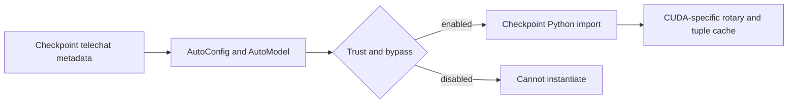
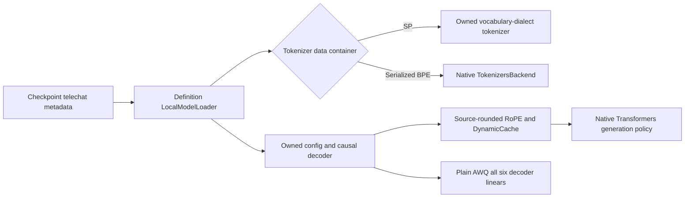

# TeleChat2 / TeleChat Transformers 5 port

GPT-QModel owns configuration, decoder, generation and tokenizer selection for
`telechat`. Transformers 5.23.0 has neither an exact native config mapping nor a
causal-LM mapping. No checkpoint Python, `auto_map` import, CUDA extension or
download is used by the modeling implementation. Normal Hugging Face asset
resolution remains available for data files; class paths are package constants.

## Source and licenses

Sources were inspected before execution. `provenance.json` records exact file
SHA-256s, per-file ModelScope revisions and fixture hashes:

- [Official Tele-AI repository](https://github.com/Tele-AI/TeleChat2/tree/a74e1e9f86adebb156bff286b343b5f292214bc5).
- [TeleChat2-7B-32K](https://huggingface.co/Tele-AI/TeleChat2-7B-32K/tree/e82932bf48391c89242fd7e28730c5e8a7992509),
  including modeling/config/tokenizer/generation and the full checkpoint index.
- ModelScope `TeleAI/TeleChat2-3B`, `TeleAI/TeleChat2-35B-32K` and
  `TeleAI/TeleChat2-115B`; their individual immutable revisions are in the manifest.
  Every downloaded source/metadata/vocabulary file was independently SHA-checked
  against its ModelScope file record. No uninspected checkpoint model was run.
- [Original TeleChat-7B](https://huggingface.co/Tele-AI/telechat-7B/tree/0c33078695dff4d41bed535c1d9d9c89db947a4c)
  supplies the older serialized Bloom BPE and a **headless** decoder inventory.

The modeling/configuration source headers license code under Apache-2.0;
`LICENSE` and `NOTICE` retain license/attribution. Model licensing is separate:
35B/115B README text references a community license requiring prior commercial
authorization, despite Apache metadata on some cards. The verbatim accessible
legacy PDF is retained, not represented as definitive terms for every later
release. Confirm model/tokenizer artifact rights with Tele-AI; this is not an
Apache-only model-license claim. The original `Tele-AI/TeleChat2-7B` endpoint
returned HTTP 401; the accessible official 7B-32K is identified explicitly,
not silently substituted in a trained-model quality claim.

## Resolution change

| Boundary | Before | After |
| --- | --- | --- |
| Config/model | Checkpoint Auto classes and trust flags | Definition-owned packaged classes |
| Tokenizer | Checkpoint Python lookup | Owned SentencePiece / exact native serialized BPE |
| Precision | Definition forces FP16 | FP32, FP16 and BF16 tested |
| Rotary | CUDA construction, release-specific half tables | Call-local device tables, same source rounding |
| Cache | Legacy tuples; continuation appends last token only | Transformers DynamicCache, complete chunk append |
| AWQ | Guessed residual/mask replay | Explicit no-search plain quantization |
| Headless input | Source hides missing LM head | Missing causal weights fail explicitly |





## Architecture and compatibility boundary

Every block owns two RMSNorms, separate query, **KV-head-interleaved K/V**,
biased attention output, gated SiLU up/gate and biased down projection. Both
pre/postnorm residual policies and optional embedding RMSNorm are tested. The
legacy rotary dialect uses base 10000 and half tables; newer 7B/35B releases use
configured theta and config-selected table precision. The trigonometric table
is half-rounded **before** amplitude scaling. Dynamic NTK uses the physical
cached sequence length. Already rotated cached keys remain frozen when the
base changes; this deliberately does not rerotate old keys. Cache continuation
is compared with incremental source equations, not a different full-context
recompute. Attention can run eager or SDPA; requesting attention probabilities
uses eager equations. FlashAttention is not exposed as a qualified path.

The source's last-token-only cache append is extended to preserve every token
of a continuation chunk. Legacy BF16 eager execution explicitly casts rotated
Q/K back to compute dtype (upstream half-table promotion otherwise mixes
matmul dtypes). These are documented runtime adaptations, not claims that the
unmodified old CUDA source supports those cases. Static/offloaded/quantized and
legacy tuple caches are rejected. Foreign cache interchange is not qualified.
Original threaded chat/streamer helpers are outside this causal-LM interface;
use the tokenizer's released chat template and ordinary generation API.

SP token-ID/AddedToken assembly is owned by this Python tokenizer backend,
not a GPT-QModel normalization shim. The actual SP dialect distinguishes modern
tool tokens from legacy control tokens. Modern source does not install an UNK
token; legacy source forwards its declared UNK and single-word token objects.
The exact raw SP bytes are saved even after source deletion. Explicit BOS/EOS
construction flags survive both saves (HF5's generic saver otherwise drops
these Python-backend fields). Outer Tokenicer still normalizes once. The old
Bloom tokenizer uses its exact Rust serialization, not a regex approximation.

Full inventories: 3B 243, 7B-32K 303, 35B-32K 643 and 115B 963 causal keys.
All match meta models exactly. All 65 actual 35B/115B safetensors shard headers,
1606 tensor shapes, also match independently; no trained tensor payload was
downloaded. The two bin-index releases prove names, not independently observed
trained shapes. Original TeleChat-7B has 302 bare decoder keys and **no LM
head**; it matches `TelechatModel` only. Loading that as a complete causal
checkpoint fails instead of inventing trained output weights. Its BPE assets
are independently qualified, not a trained causal-model qualification.

## Validation and integration

Validation baseline: direct parent `bf4003dabad138a9245e55c87151d354a632bb97`,
including the human main merge. Public AWQ tests use only the new
`CalibrationConfig(dataset=..., batch_size=1, min_length=1)` API.
Python 3.14.6t / GIL disabled, Transformers 5.23.0, Torch 2.15.0+cpu,
published Tokenicer 0.0.19 and SentencePiece 0.2.3. The oracle JSON was generated
separately with Transformers 4.57.6 and the fully inspected pinned upstream
tokenizer classes (actual 115B class, not a substituted constructor).

Core command (no network required):

```bash
PYTHON_GIL=0 /home/ubuntu/.venvs/gptqmodel-tf5/bin/python -s -m pytest -q \
  tests/test_telechat2_local_port.py tests/module_tree/test_telechat2_local_port.py
```

Tests include independent float64 full-decoder/attention/rotary/cache equations,
MHA/GQA/MQA, both residual modes, both rotary policies, eager/SDPA, three dtypes,
greedy source-token equality and real beam execution, EOS policy/overrides,
tuple outputs/loss, failure/repair, malicious model/tokenizer `auto_map` with
trust false/true and bypass absent/0/1, real multilingual/NUL/special IDs/chat,
source-deleted vocabulary serialization, two dense saves/reloads, and six
actual public plain-AWQ cases with `fallback=None`, offload false/true, all
twelve decoder linears packed and every packed/excluded tensor exactly equal
after **two** quantized saves/reloads. No scale-fold/search qualification is
claimed; no source norm is modified by the plain policy.

Original controlled config-selection regression: six intended failures before
the loader binding, six green after. Generic HF5 saving lost owned BOS/EOS
flags: six public reload reds before the owned serializer repair. A separate
headless-input regression first proved native loading silently invented an LM
head, then verifies explicit rejection. Deliberate KV-layout, table-rounding
and residual-policy mutations are checked against independent equations.
Exact final gates/results and mutation outcomes are recorded in `EVIDENCE.md`.

Parent integration owns central docs/main README/PR diagrams and package-data
coverage for LICENSE, NOTICE, PDF, JSON and gzip assets. Registered module plan
is unchanged. Replace only the `telechat` fusion reason with:

> Package-owned TeleChat/TeleChat2 interleaved-KV dense decoder with source-rounded dynamic NTK RoPE; fusion executor has not been qualified.

No generic AWQ family-set addition is required (`telechat` is not in that
suite's family list). No shared code/dependency/registry/PR lifecycle edits
belong to this port. SentencePiece floor 0.2.1 must remain supported.

Unqualified: full trained checkpoint payloads/quality, GPU/FlashAttention,
optimized/fused kernels, multi-GPU, concurrent PyTorch execution, compilation,
training, quantized/static/offloaded/foreign cache interchange, extended-context
quality and fusion. PIL/media and other TeleChat MoE architectures are not
part of this dense decoder. No claim is based on skipped trained-model tests.
