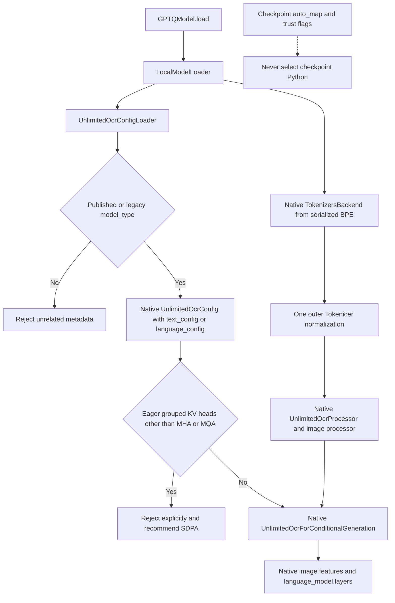
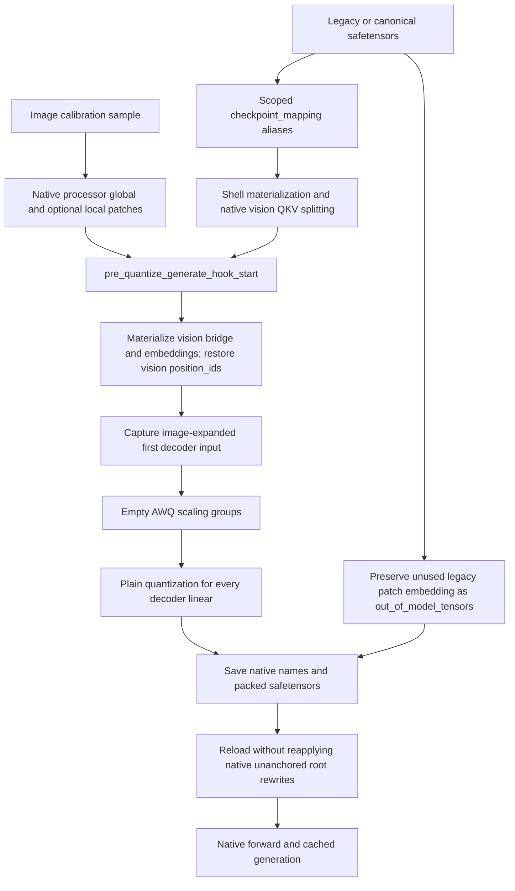

# Unlimited-OCR native task, media and checkpoint ownership

GPT-QModel selects Transformers 5's exact `UnlimitedOcrForConditionalGeneration`,
not `AutoModel`'s headless `UnlimitedOcrModel`. Both `unlimited_ocr` and the
historical `unlimited-ocr` alias use the same definition. No decoder, vision
model, cache or generation implementation is duplicated. The narrow local
boundary selects native classes, canonicalizes the legacy alias, binds native
media and serialized BPE assets, and rejects a measured native eager-GQA defect.

## Resolution and lifecycle





| Boundary | Before | After |
| --- | --- | --- |
| Task | `AutoModel`, headless native model or checkpoint Python | Exact native conditional generation |
| Trust | `require_trust_remote_code=True` | Local model/config/tokenizer/processor selection under every trust/bypass setting |
| Alias | Native config rejects hyphenated model type | Validate then canonicalize the one published legacy alias |
| Decoder tree | `model.layers`, `model.norm` | `model.language_model.layers`, `model.language_model.norm` |
| Media | Dynamic import of checkpoint module and remote image lists | Native processor tensors, global/local crops and patch geometry |
| Lazy conversion | Incomplete nested SAM aliases and unanchored root rewrites | Scoped aliases, vision QKV splitting, native canonical saves |
| AWQ | Unqualified legacy scaling assumptions | Explicit plain-only policy, no folding/search claims |
| Eager GQA | Native head-count dimension error | Actionable rejection; SDPA retry qualified |

The old mechanism is at parent base `a223426fc`,
`gptqmodel/models/definitions/unlimited_ocr.py`. This unit supplies port-local
flow documentation; the parent owns central `docs/`, main README and PR flow
integration for [PR 4620](https://github.com/ModelCloud/GPTQModel/pull/4620).

## Pinned source and licenses

- Release: [baidu/Unlimited-OCR at 8249d20b2822a7d8a4c22c8d8c9069b5ac36bda3](https://huggingface.co/baidu/Unlimited-OCR/tree/8249d20b2822a7d8a4c22c8d8c9069b5ac36bda3).
- Inspected `modeling_unlimitedocr.py`, `modeling_deepseekv2.py`,
  `configuration_deepseek_v2.py`, `deepencoder.py`, and `conversation.py` as text;
  none is executed or shipped as runtime modeling code.
- Baidu MIT license is retained byte-for-byte in `LICENSE`; see `NOTICE` and
  `source_manifest.json` for provenance and SHA-256 values.
- Native classes come from the installed Apache-2.0 Transformers dependency,
  qualified here on **5.23.0**. Package paths are lazy-loaded by `LocalModelLoader`.
- Fixtures contain actual config/tokenizer/processor/generation assets, a
  checkpoint index and a derived JSON representation of the safetensors header.
  Gzip is storage compression only. There are **no trained tensor payloads**.

The full release header has **2,710 tensors**. Independent inverse names and
shapes match all **2,709 native-executed source entries** after vision QKV
fusion. The remaining `model.vision_model.embeddings.patch_embedding.weight`
has shape `[1024, 3, 14, 14]`; the inspected source declares it but passes SAM
embeddings directly to its vision transformer. Native Transformers also omits
that unused convolution. It is not fabricated as an executed module: the
definition preserves the original tensor through **quantized** saves using the
existing `out_of_model_tensors` contract. Two consecutive packed save/reloads
check the synthetic source's original FP32 storage and every executed
packed/dense tensor exactly.
Native `model.save_pretrained()` exports the native executed model only.

## Qualified behavior

Both aliases and legacy `language_config`/native `text_config` layouts are
covered by actual public loads, not just registry mocks. Dense-only,
routed/shared MoE-only and mixed decoder layouts have CPU/meta live-owner and
module-plan checks, including biases and MHA/MQA/GQA. An independent float64
decoder oracle computes RMSNorm, rotary positions, attention,
dense/SwiGLU and routed/shared expert mixing without native math helpers.
Eager MHA/MQA and SDPA MHA/GQA/MQA have FP32/FP16/BF16 cache continuation,
beam generation and safetensors roundtrips. Direct native eager GQA is shown
to fail; the local boundary rejects it before loading and permits an SDPA retry.

Native media tests use nonconstant global images and horizontal/vertical
two-tile local patches, all three dtypes, exact image-token counts, greedy and
three-beam cached/uncached output-score comparisons. Real serialized BPE IDs,
multilingual whitespace, BOS/EOS/padding/image tokens, processor pixels and the
actual released generation policy survive two dense reloads. The latter retains
`no_repeat_ngram_size=35`, `no_repeat_ngram_window_size=128`,
`max_new_tokens=32768` and explicit call overrides.

Twelve actual hostile public load/save cases cover native/legacy source keys,
trust false/true and bypass absent/`0`/`1`. Model, config, tokenizer and processor
sentinels never execute. Each dense load normalizes with Tokenicer exactly once;
source config and tokenizer bytes remain unchanged. Corrupt source repair/retry
is exercised on the same path.

**AWQ: plain quantization only.** Six actual public image-calibrated cases cover
dense/mixed/sparse layouts and disk offload false/true with `fallback=None` and
only `CalibrationConfig(dataset=..., batch_size=1, min_length=1, sort="desc")`.
All **14/26/38** decoder projections respectively quantize; vision, embeddings,
norms, router and LM head remain dense. Independent source first-decoder input
capture proves that image features reach calibration. Every packed and excluded
dense tensor, the unused legacy patch embedding and image logits survive two
exact saves/reloads. No shared AWQ algorithm or generic family set is changed.

## Regressions and commands

Environment: Python **3.14.6t**, `PYTHON_GIL=0` (verified disabled), Torch
**2.15.0+cpu**, Transformers **5.23.0**, published Tokenicer **0.0.19**
(`direct_url.json` absent), defuser **0.0.31**, safetensors **0.8.0**,
Pillow **13.0.0**. Ruff gate is **0.14.2** (not the venv's unrelated 0.17.5).

Negative probes were actually run:

| Probe | Intended red | Repair/green |
| --- | --- | --- |
| Restore old `AutoModel` selector in process memory | 12 failed in 0.95s: headless native task, alias/remote dispatch | Definition-owned generative selector and security matrix |
| Omit unused release patch embedding from save contract | Public dense-layout AWQ save loses its source tensor, 1 failed in 5.01s | Explicit out-of-model tensor, 6 AWQ cases passed in 30.13s |
| Old lazy materialization/position buffer path | 6 actual image-AWQ cases failed with meta/device errors in 13.50s | Scoped SAM/vision aliases and restored vision position IDs |
| Native eager GQA | Real independent head-count matrix-multiply failure | Actionable rejection and SDPA retry; no skip |
| Auto-discovered hostile serialized tokenizer on Tokenicer 19 | 12 public dense saves fail with non-JSON `UnlimitedOcrConfig` | Source-exact native serialized-BPE selection; two saves pass |

The generic Tokenicer 19 fallback also reproduces with plain `LlamaConfig`
outside GPT-QModel. It was independently confirmed by Tokenicer's owner and is
being fixed upstream; this unit retains published 19 and adds no normalization
shim or dependency change. Early environment labeling was audited: initial
small probes used installed 14; final results below use verified published 19.

Run from repository root:

```bash
PYTHON_GIL=0 /home/ubuntu/.venvs/gptqmodel-tf5/bin/python -s -m pytest -q \
  tests/test_unlimited_ocr_local_port.py \
  tests/module_tree/test_unlimited_ocr_local_port.py --tb=short

PYTHON_GIL=0 /home/ubuntu/.venvs/gptqmodel-tf5/bin/python -s -m pytest -q \
  tests/test_awq_scale_search_safety.py tests/test_awq_moe_router_scaling.py \
  tests/test_awq_empty_groups.py tests/test_awq_position_kwargs.py \
  tests/test_awq_scale_search_memory.py tests/test_bloom_awq_replay.py \
  tests/module_tree/test_awq_relationships.py \
  tests/module_tree/test_bloom_awq_relationships.py \
  tests/module_tree/test_registered_module_plans.py \
  tests/module_tree/test_definition_subset_ordering.py --tb=short

PATH=/home/ubuntu/.local/bin:$PATH ./format/check.sh
git diff --check
```

The unmodified central registry fixture produces **2 expected owned-prefix
failures**, **572 passed, 3 skipped** in **15.46s**. No central file is changed.
For integrated qualification apply only `central_fixture_proposals.json` to
`test_registered_module_plans.INVENTORY["cases"]["UnlimitedOCRQModel/gptq"]`
and `test_fusable_models.INVENTORY` **in memory** before `pytest.main`.
The combined owned/loader/processor/tokenizer/registry/fusion/AWQ/fold run
passed **1,135**, skipped **468**, with **16 warnings** in **113.91s**.
Skips: **460 NVIDIA Marlin hardware**, three absent DeciLM/Exaone/Nanbeige
fixtures, three absent Pangu fixtures, and two non-buildable opt350/muse_glimmer
CausalLM fixtures. No deselections or expected failures. The owned tests alone
passed **147**, with no skips, in **97.05s**; the strengthened once-normalization
and immutable-source-asset matrix additionally passed **12** in **42.00s** and
is included in the final combined run. The existing dataset
helper additionally passed in **3.59s**. Port Pyright: **0 errors/0 warnings**;
including the dynamic BaseQModel definition reports **17 diagnostics**, not a
clean whole-definition type-check. The owned runtime suites pass independently.
Compileall, package discovery, full pinned Ruff and diff checks pass.

Parent integration must replace the exact native-prefix case and both alias
fusion reasons from `central_fixture_proposals.json` (the eleven ordered blocks
are unchanged). The existing shared `tests/test_unlimited_ocr_support.py`
contains obsolete AutoConfig mocks, remote image layouts and old paths:
actually run, **10 failed/2 passed**. The parent owns its native migration.
No fallback compatibility is retained just to satisfy stale fake modules.

## Explicit limits

No full trained payload, OCR quality score, NVIDIA/AMD/Apple accelerator,
FlashAttention/other optimized kernel, multi-GPU, concurrent PyTorch execution,
torch.compile, training, fusion executor, AWQ folding/search safety,
extended-context accuracy or static/offloaded/quantized foreign-cache claim is
made. The existing trained `/monster/data/model/Unlimited-OCR` test was migrated
but is not executable here because its local checkpoint and accelerator are
absent. Single-sample media calibration is intentional. Native eager GQA is
unsupported and must use SDPA. Ordinary native cache ownership is retained;
tests do not establish cache portability to another model instance.
