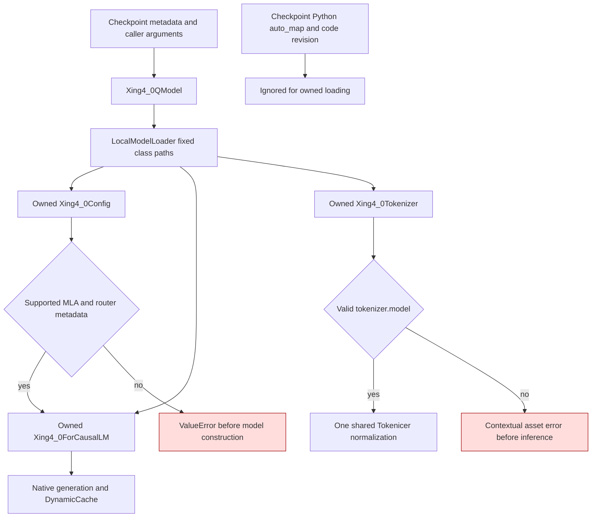
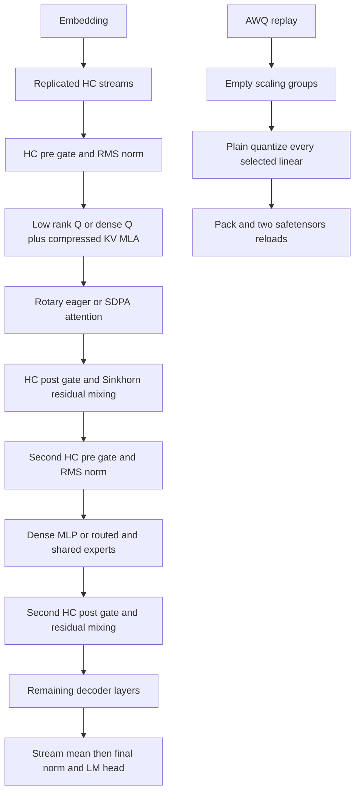

# Xing4.0 package-owned Transformers 5 port

GPT-QModel selects this model, config and tokenizer directly through
`Xing4_0QModel.loader`. Transformers 5.23.0 has neither an exact `xing4_0`
config mapping nor a causal-LM mapping. The actual decoder is **not** a native
Llama/DeepSeek alias: it has MLA projections, interleaved rotary, Sinkhorn
hyperconnections, dense first layers and routed/shared experts.

## Provenance and license

Authoritative release:
[XingChen-AGI/Xing4.0-29B-A4B](https://huggingface.co/XingChen-AGI/Xing4.0-29B-A4B/tree/acbdebfe496d117e6fde3ce152d2450fb0d5fa53),
revision `acbdebfe496d117e6fde3ce152d2450fb0d5fa53`.
The complete original Apache-2.0 LICENSE is preserved byte-for-byte; NOTICE
records attribution and modifications. `assets/source_manifest.json` records
SHA-256 and byte lengths for the inspected original config, modeling,
tokenizer, license, README, data assets and twelve real safetensors headers.
No downloaded checkpoint Python is imported by runtime code. Upstream source
was inspected before adaptation; the independent tokenizer oracle executes only
that inspected tokenizer in a separate Transformers 4 environment, never at
runtime and never as a model fallback.

`assets/fp8_source_manifest.json` additionally pins the official FP8 release at
`8942dcf08bcf11895e3424f1e4312a9bea26a668`. Its config describes the identical
decoder geometry with native FP8 quantization metadata. Only its metadata/meta
layout is qualified here, **not** the compressed FP8 weights or activation path.
The official GGUF distribution is not a separate Python architecture; its
converter/reader execution is outside this port's qualification.

The twelve compressed original headers and original index independently
reconstruct all **8,307** released keys/shapes/storage types: **8,095** executed
decoder/head keys and **212** auxiliary `model.layers.40.*` MTP keys. The latter
are explicitly out-of-model tensors, matching the inspected source decoder
execution boundary. They are not silently treated as quantized decoder layers.
All 39 released router correction buffers are FP32, with all other tensors
BF16. The full meta test checks exact executed names, shapes and dtypes. Tiny
public quantized saves preserve representative BF16/FP32 MTP extras through two
safetensors cycles; there is no MTP speculative-decoding claim.

## Before and after

| Concern | Before | After |
| --- | --- | --- |
| Modeling/config selection | Checkpoint Python and caller remote trust | Package-owned `LocalModelLoader` classes |
| Malicious `auto_map`, trust, bypass, code revision | Could select checkpoint implementation | Cannot replace any owned class |
| Tokenizer | Checkpoint SentencePiece Python | Owned source-matched SentencePiece class; outer Tokenicer once |
| Fresh hyperconnection construction | Source initializer addresses nonexistent `fn/base/scale` | Initializes actual `hc_fn/hc_base/hc_scale` |
| Correction buffer construction | Implicit global default dtype | Explicit FP32 plus native strict-FP32 loading policy |
| Config/optional outputs | Legacy RoPE setter and missing CausalLM tuple conversion | Canonical RoPE metadata and native tuple support |
| AWQ | Generic grouping could imply unsupported fold/search safety | Explicit empty groups; actual plain quantization |
| Fusion | Unqualified | Still unqualified; no new admission |

Old remote selection: `gptqmodel/models/definitions/xing4_0.py:18` at base
`a223426fcc3cddcd1fe09479367c4fc88e0d3d89`. New explicit class selection is
the same definition's `loader`; its AWQ override owns the plain-policy decision.





## Preserved computation and supported boundary

The owned implementation preserves low-rank Q and alternate dense Q, compressed
KV expanded to each query head, separate non-rotary/rotary dimensions, both
rotary layouts, source YaRN attention scaling, sigmoid/noaux correction-biased
global top-k routing, optional top-k normalization, routed scaling, multiple
shared experts, source Sinkhorn normalization and the final stream mean.
Source `n_group`, `topk_group` and `moe_layer_freq` are retained metadata: the
inspected implementation does not use them to select groups or skip layers.
This port does not invent a different routing policy from those field names.

The source MLA expands KV to every query head, so grouped-KV metadata is rejected
rather than silently changing computation. Distributed `ep_size != 1`, foreign
router algorithms, zero HC streams/iterations and odd rotary widths fail at
config construction. Eager and SDPA, CPU FP32/FP16/BF16, DynamicCache and ordinary
greedy/beam generation are tested. Other cache kinds and optimized attention
backends have no qualification claim.

Tokenizer behavior preserves exact pinned SentencePiece IDs, CJK/Unicode,
whitespace, embedded NUL, source special tokens, pairs, all BOS/EOS flag
combinations, thinking/nonthinking prompts, and deleted-source save/reload.
Original vocabulary bytes are retained because SentencePiece serialization
need not reproduce source bytes. Saved mutable BOS/EOS flags are explicit.
There is no downstream tokenizer normalization shim. Tokenizer parse errors
use a contextual RuntimeError so Transformers 5 does not replace the useful
filename with an unrelated TikToken error. The official Jinja template remains
byte-identical; narrow `.gitattributes` preserves source whitespace.

### Plain AWQ policy

MLA low-rank norms, nonlinear gates, HC stream mixing, routed and shared expert
consumers have no qualified fold/search/replay equivalence proof. Consequently
`awq_get_modules_for_scaling()` returns an empty list, even with `fallback=None`.
Six actual public CPU AWQ cases cover dense-Q and low-rank-Q, bias/no-bias,
dense-only/routed-only/mixed layers and disk offload false/true. They assert:

- Independent embedding-to-first-decoder HC stream capture, not text-only hooks.
- Every selected physical decoder linear becomes a real `AwqTorchLinear`.
- Every excluded norm/router/HC tensor and head/embedding is unchanged.
- FP32 router correction buffers retain nonrepresentable adversarial values.
- Both packed and dense state are exact through two saved/reloaded cycles.
- Auxiliary MTP payloads remain safetensors extras, not executable layers.

Calibration uses only the current `CalibrationConfig` API. No shared AWQ
algorithm, shared tokenizer code, central fixture, dependency or PR state is
changed by this unit.

## Reproduction

Use the existing isolated environment from the repository blueprint:

```bash
PYTHON_GIL=0 /home/ubuntu/.venvs/gptqmodel-tf5/bin/python -m pytest -q \
  tests/test_xing4_0_local_port.py tests/module_tree/test_xing4_0_local_port.py

PATH=/home/ubuntu/.venvs/gptqmodel-tf5/bin:$PATH ./format/check.sh
uvx --from ruff==0.14.2 ruff check gptqmodel docs/eora tests setup.py
PYTHON_GIL=0 /home/ubuntu/.venvs/gptqmodel-tf5/bin/python -m compileall -q \
  gptqmodel/models/ports/xing4_0 gptqmodel/models/definitions/xing4_0.py \
  tests/test_xing4_0_local_port.py tests/module_tree/test_xing4_0_local_port.py
git diff --check
```

The independent released tokenizer ID/prompt oracle was also checked with the
inspected original tokenizer under Transformers 4.57.6 / SentencePiece 0.2.1
on isolated Python 3.12. That environment is never a runtime dependency.

### Measured results

Python 3.14.6t with GIL disabled, Torch 2.15.0+cpu, Transformers 5.23.0 and
the published Tokenicer 0.0.19 distribution (no VCS direct URL):

| Gate | Result |
| --- | --- |
| Owned runtime/module suite, required SentencePiece 0.2.1 | 76 passed, no skips, two native SWIG warnings, 37.85s |
| Required ten-file AWQ/model-plan baseline, SentencePiece 0.2.1 | 574 passed, three absent-checkpoint skips, 13.40s |
| Combined owned/loader/processor/HF/AWQ/registry/fusion, SentencePiece 0.2.3 | 864 passed, 464 skips, 13 warnings, 50.57s |
| Repository `format/check.sh` | Passed; local script resolved Ruff 0.17.5 |
| Explicit whole repository Ruff 0.14.2 / compileall / diff checks | Passed |
| Setuptools discovery / source hashes / Mermaid parsing | Passed |

Combined skips are exactly 460 NVIDIA Marlin hardware cases, three absent
DeciLM/Exaone/Nanbeige checkpoints and one absent optional PEFT dependency.
There are no deselections, expected failures or changed shared fixtures.
The exact combined command is:

```bash
PYTHON_GIL=0 /home/ubuntu/.venvs/gptqmodel-tf5/bin/python -m pytest -q \
  tests/test_xing4_0_local_port.py tests/module_tree/test_xing4_0_local_port.py \
  tests/test_local_model_loading.py tests/test_local_processor_loading.py \
  tests/test_hf_config_compat.py tests/test_awq_scale_search_safety.py \
  tests/test_awq_moe_router_scaling.py tests/test_awq_empty_groups.py \
  tests/test_awq_position_kwargs.py tests/test_awq_scale_search_memory.py \
  tests/test_bloom_awq_replay.py tests/module_tree/test_awq_relationships.py \
  tests/module_tree/test_bloom_awq_relationships.py \
  tests/module_tree/test_registered_module_plans.py \
  tests/module_tree/test_definition_subset_ordering.py \
  tests/module_tree/test_fusable_models.py
```

### Red/green controls

Restoring source `module.fn` in the fresh-HC initializer gives one intended
AttributeError failure (5.03s); corrected initialization and the numerical/cache
family give 19 passes (3.86s). Disabling interleaved rotary gives two intended
FP32 numerical failures, 16 unchanged layout/dtype controls (3.73s), including
426/576 mismatched logits and maximum absolute error 7.78e-5. Restoring the
source rotary layout returns that family green. Negative probes are not shipped.

The scalar YaRN oracle checks the actual release's 64-wide rotary, factor 64,
pretraining length 4096, attention scaling and positions through 262143. This
qualifies the tested math, not full-context trained-model quality or memory use.

## Integration and limitations

Parent-owned central changes are precisely listed in
`central_fixture_proposals.json`: keep the registered plan unchanged, update
only the stale fusion rationale, and integrate coverage/diagrams in central
docs and the existing PR. The parent must preserve license/notice/data files in
packaging. Setuptools discovers this package without a shared initializer edit.

No trained 29B payload or quality/perplexity claim; no trained native FP8/GGUF,
GPU, FlashAttention, fused HC/MoE, multi-GPU/EP/TP, concurrent PyTorch execution,
compile, training, foreign/static/offloaded/quantized cache, extended-context
generation, fusion executor or AWQ folding/search qualification. Disk **weight
offload during the tested quantization** is distinct from runtime cache/model
placement. Default Pyright reports 40 diagnostics on the four port Python files
and is **not clean**; runtime, Ruff and compilation results are reported
separately. The existing trained-model test is collected only, not executed.

Dependencies follow the parent policy: released Tokenicer >=0.0.19 and
SentencePiece >=0.2.1. There is no Transformers 4 runtime fallback.
