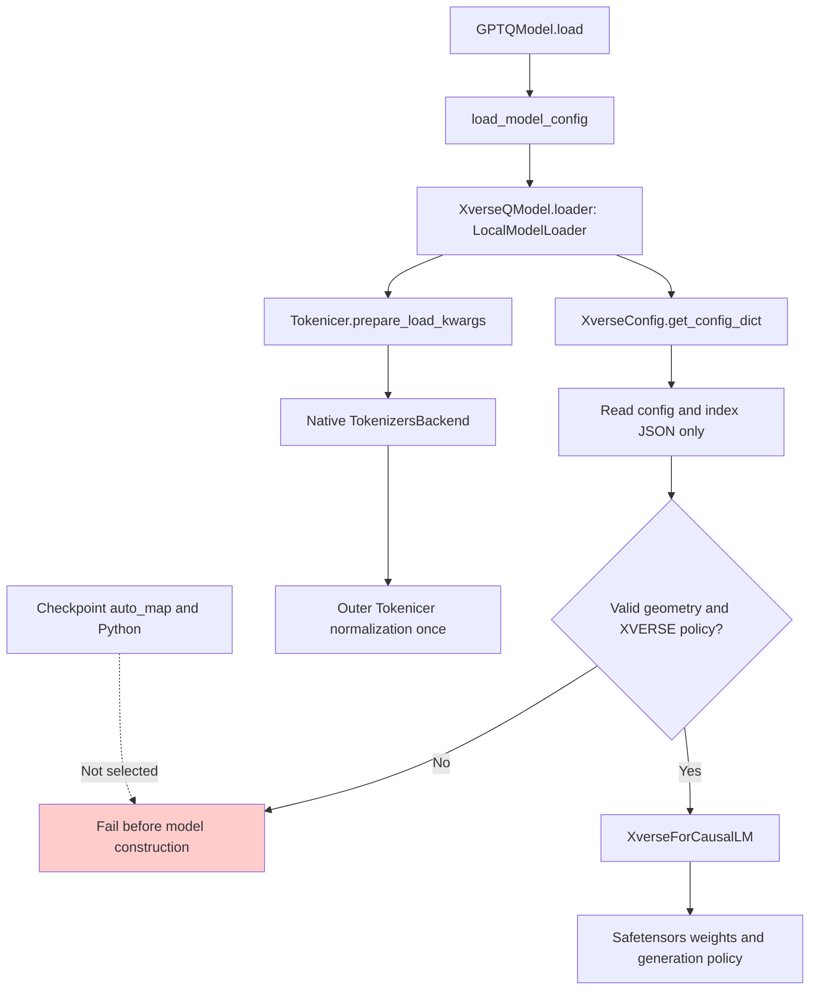
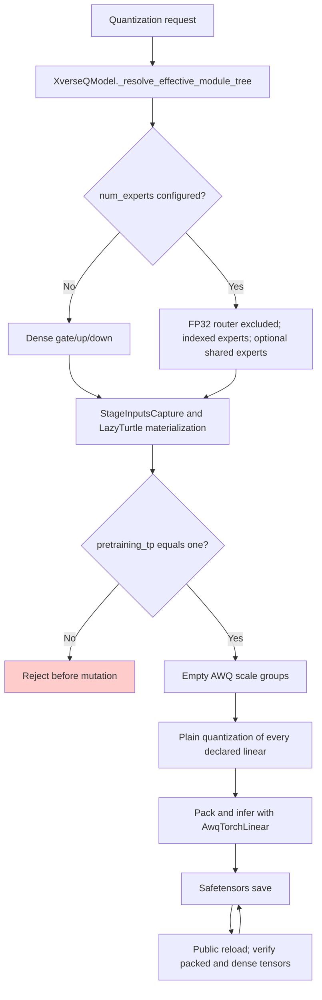

# XVERSE package-owned Transformers 5 port

GPT-QModel selects these classes directly through `XverseQModel.loader`.
Transformers **5.23.0** has neither an `xverse` configuration mapping nor a
causal-LM mapping. This is an actual XVERSE port, not a Llama substitution.

## Source and tensor ownership

`source_manifest.json` pins the inspected official Hugging Face source files
and their SHA-256s. No upstream Python is downloaded or executed at runtime.
`checkpoint_inventories.json.gz` contains the independently read checkpoint
indexes and available safetensors headers. The exact live meta-model checks
compare **37,059 keys** across **13** releases; **21,449** of those entries also
have actual safetensors-header shapes. An index-only check is not a shape or
trained-weight check.

| Official release under `xverse/` | Pinned revision | Index keys | Actual header shapes |
| --- | --- | ---: | ---: |
| XVERSE-7B | `3778b254def675586e9218ccb15b78d6ef66a3a7` | 323 | — |
| XVERSE-7B-Chat | `60acc8c453c067b54df88be98bfdf60585ab5441` | 323 | — |
| XVERSE-13B | `11ac840dda17af81046614229fdd0c658afff747` | 403 | — |
| XVERSE-13B-Chat | `1e4944aaa1d8c8d0cdca28bb8e3a003303d0781b` | 403 | — |
| XVERSE-13B-256K | `a0a34b899fb26cbac14cf518b01846839773e678` | 403 | — |
| XVERSE-65B | `2f5c3c26594741b339d05b5bdf539d3a3583a6ba` | 803 | — |
| XVERSE-65B-2 | `3f1c9ac7904404e18bf3aff5c139e51527074e8a` | 803 | — |
| XVERSE-65B-Chat | `bb1ea61dfb5037a9a0d016607bdd3f9ff9ab6666` | 803 | — |
| XVERSE-MoE-A4.2B | `3dc97ca598fd5b8325589eee134ff1bb620bddda` | 5,659 | — |
| XVERSE-MoE-A4.2B-Chat | `283b6278800a87daa6c5349c69d6ae3841cc43d8` | 5,687 | — |
| XVERSE-MoE-A36B | `2d9a062a243cb2f6a1d30434f3136145c679f76a` | 10,103 | 10,103 |
| XVERSE-Ent-A4.2B | `f37f333bf51498d0c715c8dea9660042712590b0` | 5,687 | 5,687 |
| XVERSE-Ent-A5.7B | `bb9f23cc7fe2afdfb721be31875c39d11f8a18ef` | 5,659 | 5,659 |

The model owns the exact `model.embed_tokens`, `model.layers.*.self_attn`,
`input_layernorm`, `post_attention_layernorm`, `mlp`, `model.norm`, and
`lm_head` namespaces. Routed layers own `mlp.router`, indexed `mlp.experts`,
and optional `mlp.shared_experts`. Shared-expert width is the ordinary MLP
width times `num_shared_experts`. Every declared projection, router, norm and
checkpoint-owned rotary buffer has an independent module-plan assertion.

The configured equations preserve dense versus MoE RMSNorm cast order,
FP32 routing/top-k normalization with the source's `1e-6` denominator,
shared-expert addition, attention bias, GQA/MQA, gated MLPs, and the original
`pretraining_tp` projection slices. Native Transformers 5 output and
generation protocols replace only the obsolete surrounding interfaces.
The FP32 router is declared through `_keep_in_fp32_modules_strict`; rotary
frequencies remain FP32 through dtype movement, lazy loading and saves.

Index metadata, **not repository-name guessing**, identifies releases that
serialize per-layer `rotary_emb.inv_freq`. The selected boolean is saved in
the owned configuration. Config preflight reads index JSON only, never any
legacy pickle payload. Obsolete private `_attn_implementation` metadata is
discarded; explicit caller attention requests remain authoritative. Unsupported
FlashAttention requests fail rather than silently selecting another kernel.

## Selection and generation

| Before | After |
| --- | --- |
| Definition pinned Transformers ≤4.38.2 / tokenizers ≤0.15.2 | No obsolete package caps; owned Transformers 5 classes |
| Default AutoModel/checkpoint Python selection | `LocalModelLoader` selects package-owned config/model/tokenizer |
| `trust_remote_code=True` required | Trust unset/false/true and bypass states cannot replace the port |
| Old tuple cache interfaces | Current `DynamicCache`, with explicit legacy tuple import |
| Implicit inherited Llama AWQ policy | Explicit tested plain quantization, no scale search/folding claim |



Dense default rotary, source linear/dynamic MoE scaling and the distinct
XVERSE-13B-256K dynamic base are implemented separately. The 256K base changes
at the source threshold using total cached sequence length; the port does not
reinterpret it as generic Transformers RoPE scaling. Cached old keys are not
retroactively rotated when the base changes. Generic dynamic scaling retains
its source frequency state; unrelated cache objects are not silently accepted.

Greedy and beam generation use native `GenerationMixin`, including the loaded
generation configuration, output scores and caller overrides. The source
nonstreaming `chat()` helper preserves Human/Assistant, MoE lowercase roles,
256K Exec/system handling, round truncation and source EOS placement. It is
not a generic tokenizer-normalization shim. Threaded chat streaming explicitly
fails because concurrent PyTorch execution has not been qualified.

## Tokenizer ownership

The packaged tokenizer is the native `TokenizersBackend`: serialized BPE, not
an unrelated tokenizer selected from checkpoint class metadata. Corrective
legacy JSON normalization belongs exclusively to **Tokenicer**. There is no
XVERSE-specific token replacement, loader rewrite or fallback to remote code.

Actual unmodified tokenizer/config/special-token/generation assets are retained
as gzip fixtures, with original-byte hashes in the source manifest. Independent
exact IDs/decodes/chat prompts in `tokenizer_oracles.json` were obtained using
**Python 3.11.18, tokenizers 0.15.2, Transformers 4.38.2**, from inspected source
assets, not this port. They cover Latin, Chinese, whitespace, newlines, special-
looking text, combining Unicode, NUL and emoji.

- 7B-Chat and MoE-A4.2B tokenizer SHA-256:
  `588e468eb27f757265fe6a057ea858fdeb20b86ac4d5f143bae54d68f73849ac`.
- Ent-A5.7B tokenizer SHA-256:
  `79e3e522635f3171300913bb421464a87de6222182a0570b9b2ccba2a964b2b4`.

Released Tokenicer **0.0.19** initially rejects the first two legacy Metaspace
JSONs before construction (`add_prefix_space does not match declared
prepend_scheme`). The independently reproduced evidence was supplied upstream;
do not mistake Ent's ByteLevel success for dense/MoE tokenizer qualification.
The final validation record below states whether an upstream candidate or
released fix was used. No GPT-QModel workaround is included.

**Validated upstream candidate, not a published release:** Tokenicer 0.0.20 at
`63abe8cfba72bb02d62b9df1d069d53d915883c5`,
[Tokenicer PR #67](https://github.com/ModelCloud/Tokenicer/pull/67).
Installed `direct_url.json` was independently checked against that full SHA.
Reproduce that environment without changing GPT-QModel's dependency files:

```bash
uv pip install --python /home/ubuntu/.venvs/gptqmodel-tf5/bin/python --no-deps 'tokenicer @ git+https://github.com/ModelCloud/Tokenicer.git@63abe8cfba72bb02d62b9df1d069d53d915883c5'
```

The parent owns eventual dependency/release integration. The released-19
blocker is not represented as fixed in a published package.

## AWQ source/consumer review

| Layout | Actual data flow | Qualification |
| --- | --- | --- |
| Dense/default and 256K | Input RMSNorm feeds Q/K/V; attention feeds O; post-attention RMSNorm feeds gate/up; activation × up feeds down | Plain only; source precision and complete search/replay/fold equivalence not qualified |
| Routed MoE | Same attention path; post-attention RMSNorm feeds FP32 router and every expert gate/up; selected expert outputs mix before residual | Plain only; no independent branch fold may omit the router |
| Shared MoE | Routed path plus shared gate/up/down and unweighted shared-output addition | Plain only; router and all shared/routed consumers require joint compensation |

`awq_get_modules_for_scaling()` returns an empty list deliberately.
`fallback=None` exercises the actual plain quantizer, not a fabricated fallback.
Every decoder linear is still packed. Routers, norms, embeddings, head and
rotary buffers remain dense. `pretraining_tp > 1` dense forward is supported,
but quantization fails before weight mutation because that source path reads
dense weight slices. No dense unpacked inference cache is introduced.



The six actual public AWQ cases use dense MHA, routed GQA and shared-MoE MQA,
each with `offload_to_disk=False/True`, current `CalibrationConfig` and two
save/reload cycles. Independent source embedding lookup checks the first
decoder's captured calibration inputs, not just final logits. All 14 dense or
32/38 MoE decoder linears and every excluded tensor are asserted explicitly.

## Regression evidence and reproduction

Run from the repository root using the isolated CPU environment:

```bash
P=/home/ubuntu/.venvs/gptqmodel-tf5/bin/python
PYTHON_GIL=0 "$P" -c 'import sys,torch,transformers,importlib.metadata as m; assert not sys._is_gil_enabled(); print(sys.version,torch.__version__,transformers.__version__,m.version("tokenicer"))'
PYTHON_GIL=0 "$P" -m pytest -q tests/test_xverse_local_port.py tests/module_tree/test_xverse_local_port.py
PYTHON_GIL=0 "$P" -m pytest -q tests/test_awq_scale_search_safety.py tests/test_awq_moe_router_scaling.py tests/test_awq_empty_groups.py tests/test_awq_position_kwargs.py tests/test_awq_scale_search_memory.py tests/test_bloom_awq_replay.py tests/module_tree/test_awq_relationships.py tests/module_tree/test_bloom_awq_relationships.py tests/module_tree/test_registered_module_plans.py tests/module_tree/test_definition_subset_ordering.py
bash format/check.sh
ruff format --check gptqmodel/models/definitions/xverse.py gptqmodel/models/ports/xverse tests/test_xverse_local_port.py tests/module_tree/test_xverse_local_port.py tests/models/test_xverse.py
"$P" -m compileall -q gptqmodel/models/ports/xverse gptqmodel/models/definitions/xverse.py tests/test_xverse_local_port.py tests/module_tree/test_xverse_local_port.py
git diff --check
```

Controlled defect probes mutate the real implementation within one isolated
pytest process, never the expected values:

| Injected defect | Actual red result | Independent detector |
| --- | --- | --- |
| Restore pre-port AutoModel loader binding | 6 failures / 1.55 s | Actual public Ent trust/bypass model/tokenizer cases |
| Cast dense normalized activations before multiplying FP32 norm weight | 2 failures, 4 controls passed / 0.18 s | FP16/BF16 mixed-precision source equations |
| Treat 256K rotary as default dense rotary | 1 failure, 4 controls passed / 0.29 s | Independent long-context decoder/rotation equations |

The matching unmodified suites pass. Additional strong checks cover all MHA/
GQA/MQA × attention-bias ownership variants, FP32/FP16/BF16 eager/SDPA decoder
equations, near-262144 rotary positions, cache chunks 1+4+1+1 crossing the
original context, optional outputs/router loss, `assign=False/True`, corrupt
safetensors recovery, warm tokenizer corruption/repair, source chat prompts,
and two exact dense and packed safetensors cycles. The public hostile matrix
uses `trust_remote_code=False/True` × bypass absent/0/1; sentinel checkpoint
Python and custom generation code must remain unexecuted.

### Final qualification record

Python **3.14.6 free-threaded / GIL disabled**, Torch **2.15.0+cpu**,
Transformers **5.23.0**, exact **unreleased** Tokenicer candidate above:

| Gate | Observed result |
| --- | --- |
| Complete owned model and module-tree suites | **150 passed, 0 skipped**, 34.44 s |
| Original required AWQ/registry baseline, before proposed central fixture | 573 passed, 3 skipped, 1 expected XVERSE excluded-rotary registry mismatch, 9.28 s |
| Candidate loader/security/processor/AWQ/registry/owned combined run | 874 passed, 4 skipped, 1 stale shared constructor-count assertion, 40.30 s |
| Combined run plus fusion admission/config/merge, proposed shared changes applied **in memory only** | **1,034 passed, 464 skipped**, 46.71 s |
| Inspected upstream file SHA-256 controls | All **104** source/metadata files match, plus code license and gzip-asset checks |
| Whole `format/check.sh` / Ruff 0.14.2 | Passed |
| Owned Ruff formatting / compileall / package discovery / diff checks | Passed |
| Both Mermaid diagrams, parser 11.12.0 | Passed |
| Existing trained-weight test | 1 collected, **not executed** |
| Default Pyright, owned runtime package | **13 diagnostics; not clean** (native config/generation/cache/mixin protocols included) |

The combined skips are **460 NVIDIA/Marlin hardware cases**, three unavailable
DeciLM/Exaone/Nanbeige checkpoint fixtures, and one absent optional PEFT probe.
None is counted as model or kernel qualification.

The shared failure is not a runtime failure or an ignored malformed asset:
`test_broken_owned_tokenizer_fails_then_repairs_without_auto_fallback[malformed]`
assumes one failing owned-constructor call. Tokenicer 20 now rejects the invalid
JSON before construction, so the correct count is zero, followed by exactly one
successful constructor call after repair. No fail-closed, no-Auto-fallback or
repair assertion is removed. Its exact proposed expectation is recorded beside
the registry proposal; the parent owns the shared test edit.

For the final combined run, the ordinary commands above were extended with
`tests/test_local_model_loading.py`, `tests/test_local_tokenizer_loading.py`,
`tests/test_local_processor_loading.py`, `tests/test_hf_config_compat.py`,
`tests/test_trust_remote_code_isolation.py`, `tests/module_tree/test_fusable_models.py`,
`tests/module_tree/test_fusable_config.py` and
`tests/module_tree/test_fusable_merge.py`, plus both owned suites. The registry
case and fusion reason were replaced in the tests' `INVENTORY` dictionaries;
only the shared malformed case's expected constructor count was replaced in
its inspected Python function in memory. No shared file or runtime was changed,
no test was deselected, and no expected model tensor was replaced. The original
failing result is retained above so this is not a claim that untouched shared
fixtures already match the port.

`central_fixture_proposals.json` contains the exact proposed shared registry
case (excluded per-layer rotary buffer) and the unqualified fusion reason.
The parent integrator owns those central fixtures, central `docs/`/README/PR
diagrams and packaging changes. Generic AWQ family sets need **no** change:
`xverse` is not present in that baseline's `FAMILIES`. Shared fixtures were not
edited by this unit; combined qualification applies only the proposed registry
case in memory.

## Limits and licensing

- No trained-weight download, generation-quality, benchmark or GPU claim.
- No FlashAttention, multi-GPU, model disk placement, torch.compile, concurrent
  PyTorch/threaded streaming, training, static/offloaded/quantized foreign-cache,
  folding/search, fusion or full-length 256K inference qualification.
- Long-context equations and boundary positions are qualified, not full-context
  memory use or trained perplexity. Source dynamic RoPE cache-retention behavior
  is preserved, not upgraded to fresh-prefill equivalence across base changes.
- Dense tensor-parallel slicing is not distributed tensor-parallel execution.
- Source helper streaming is explicitly unsupported, not silently rerouted.
- The unrelated `xverse/XVERSE-V-13B` repository at
  `7a50e375498c5d97144430c8913566f88fa13582` exposes no configuration, model
  Python or checkpoint inventory (pinned `config.json` returns HTTP 404).
  No visual architecture or support was invented for that empty repository.

Code is Apache-2.0; `LICENSE` preserves the official XVERSE-7B code license
from upstream git revision `551dea7e53be070e9f76188e450467200af320f2`.
See `NOTICE` for retained upstream attribution and the manifest for hashes.
The original model cards distinguish that code license from their model/weight
licenses (`MODEL_LICENSE.pdf`, including use conditions). This port grants no
additional rights to upstream weights or tokenizer data and bundles no trained
tensor payloads.
