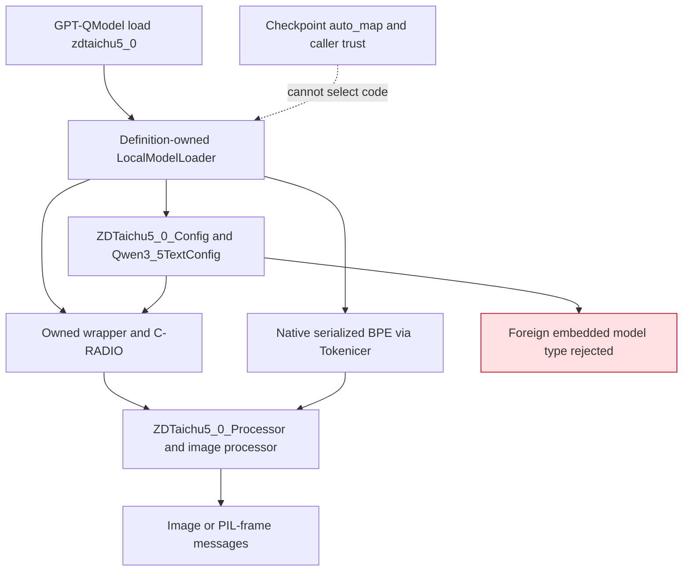
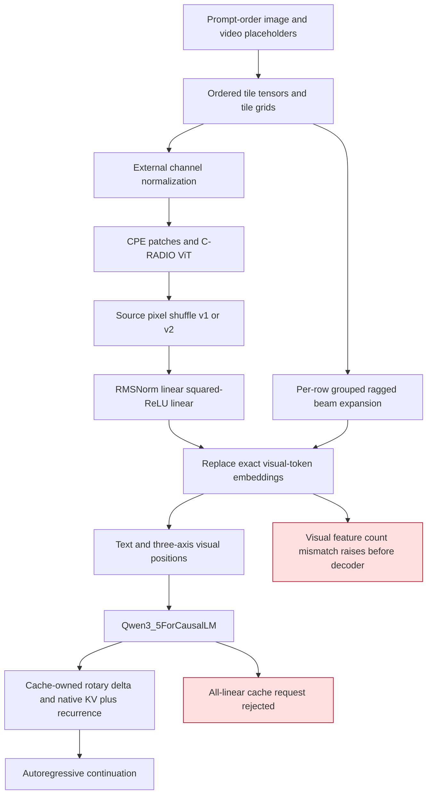

<!-- SPDX-FileCopyrightText: 2026 ModelCloud.ai
SPDX-License-Identifier: Apache-2.0 -->

# ZDTaichu5 local Transformers 5 port

## Ownership and provenance

GPT-QModel binds `zdtaichu5_0` to this package through `LocalModelLoader`.
Transformers 5.23.0 has no native config/causal-LM mapping for this wrapper.
Its native `Qwen3_5TextConfig` and `Qwen3_5ForCausalLM` are reused **without a
decoder copy**. The similarly named native RADIO implementation has different
checkpoint owners and is not a substitute for this released C-RADIO tower.

Authoritative release:
[TaichuAI/ZDTaichu5.0-9B](https://huggingface.co/TaichuAI/ZDTaichu5.0-9B/tree/bc125a9819a421755f4dcebe498eb81c139b65a3),
pinned to `bc125a9819a421755f4dcebe498eb81c139b65a3`.
Source files were inspected as text, not imported from the checkpoint:
`configuration.py`, `modeling.py`, `cradio_config.py`, `cradio_model.py`,
`image_processing.py`, `processing.py`, and `vision_utils.py`.
The source SHA256 manifest is `fixtures/sha256.json`.
Compressed fixtures contain the real config, tokenizer BPE/metadata/chat template,
image/processor/generation metadata, checkpoint index and independently fetched
safetensors **headers only**. No trained tensor payload is included.

All **820** released keys and shapes are exactly represented on `meta`:
427 native language-model, 390 C-RADIO, and three `mlp1` parameters.
The released wrapper removes its input conditioner after moving normalization
outside the vision tower, but the checkpoint retains its two buffers. This port
retains those exact owners and skips the conditioner during externally normalized
vision execution, avoiding missing/unexpected keys or double normalization.

### Licenses and restrictions

Preserve the byte-identical release `LICENSE`, `NOTICE`,
`THIRD_PARTY_LICENSES.md`, and `LICENSES` files. The release is covered by the
**NVIDIA Open Model License**, not an Apache-only grant. Its definition of Model
includes software/configuration; it permits commercial use but requires the
Agreement and NVIDIA attribution on distribution and retains lawful-use and
other restrictions. In particular preserve:
“Licensed by NVIDIA Corporation under the NVIDIA Open Model License”.
Do not confuse this agreement with NVIDIA's noncommercial research license used
by some unrelated models. Qwen3.5 source/artifacts are Apache-2.0; image-processing
code retains OpenGVLab attribution and its MIT license. `LICENSES/InternVL-LICENSE`
is pinned to OpenGVLab/InternVL `c62fa4f7c850165d7386bdc48ac6bc5a6fab0864`.
Its SHA256 is `8f03d25fbcffafa2254d4d1414bf2a38423a966006b4a6964ee21f728d610bff`.
This description does not replace the actual agreements.

## Resolution and tensor flow

Old dispatch is pinned at `a223426fcc3cddcd1fe09479367c4fc88e0d3d89`,
`gptqmodel/models/definitions/zdtaichu5.py` (`loader` and
`require_trust_remote_code` declarations). Old media concatenation is in the
pinned upstream `processing.py::__call__`; new dispatch is in the same definition
and `processing.py::ZDTaichu5_0_Processor.from_pretrained` in this package.

| Boundary | Before | After |
| --- | --- | --- |
| Definition | Remote AutoModel with required trust | Explicit package-owned config/model/processor/tokenizer |
| Checkpoint Python | Selected by `auto_map` when trusted | Never used, including trust plus safety bypass |
| Decoder | Remote wrapper around Qwen3.5 | Exact current native Qwen3.5 |
| Vision | Checkpoint C-RADIO/timm classes | Package-owned C-RADIO, lazily imported timm |
| Media order | Images appended before video frames | Payloads appended in actual placeholder order |
| Tokenizer | Checkpoint discovery | Exact native serialized-BPE class; Tokenicer normalizes |
| Generation state | Wrapper-level mutable rotary state | Rotary deltas belong to each native cache |
| AWQ | Inherited fold/search assumptions | Explicit plain quantization; no scaling groups |





Video frames reuse the source per-frame image expansion and source timestamp text;
this is not a newly invented temporal attention layout. Image geometry derives
from the selected model configuration before processor construction, including
derived visual-token counts. Source `TAICHU_VIDEO_READER` environment selection
is removed; optional container decoders remain lazy. No new environment behavior
switch is introduced.

## Qualified boundary

Tests use real modules, no checkpoint Python and no trained weights. Environment:
Python 3.14.6t with `PYTHON_GIL=0`, Transformers 5.23.0, Torch 2.15.0+cpu,
published Tokenicer 0.0.19, timm 1.0.22. Native eager and SDPA are selected explicitly
for both decoder and ViT; FlashAttention is not qualified.

| Area | Evidence |
| --- | --- |
| Release inventory | Every real index/header key and shape exactly equals real meta construction |
| Module plans | CPU/meta full, linear and hybrid layouts; MHA/GQA/MQA; projection bias off/on; Defuser; exact live owners/exclusions; sole registry alias |
| Numerical vision | Independent float64 patches, CPE, QKV attention, MLP, spatial merge and projector; both pixel-shuffle versions; captured decoder embeddings |
| Processor/tokenizer | Real pinned BPE versus raw tokenizer oracle; English/CJK/accent/newline/special IDs; image normalization equation; video-before-image order; save/reload |
| Security | Public load with hostile model/config/tokenizer/image/processor `auto_map`, hostile tokenizer class and Python sentinels; trust None/False/True x bypass absent/0/1; media forward/generate |
| Dtypes/native execution | FP32/FP16/BF16 forward; full/hybrid cache continuation; greedy/beam; source M-RoPE position/delta equation |
| Cache and beams | Interleaved separate-cache requests, ragged left-padded rows with unequal tile counts, exact grouped media and per-step logits versus independent row generation |
| Lifecycle | Native state assignment both modes; dense two exact safetensors cycles; corrupted payload and processor asset repair/retry; visual mismatch before cache mutation |
| Generation policy | Actual released policy fields, seeded sampling and every score, additional EOS stop, explicit caller override, immutable caller/root configs, two exact save/reload cycles |
| Public AWQ | Six real image-calibrated fallback=None plain-AWQ runs; offload False/True; full/hybrid MHA/GQA/MQA and bias; 13/14 decoder projections; every excluded dense tensor exact; two exact packed+dense reloads and logits |

AWQ tests use the current public `CalibrationConfig` API and independently compute
the visual first-decoder input. No fold/search safety, fusion, activation
quantization or general plain-family admission is inferred from these results.

### Red/green evidence

| Probe | Intended failure | Repaired/restored result |
| --- | --- | --- |
| Source image-first concatenation with earlier video placeholder | Real video-before-image tensor equality failed in 3.40s | Prompt-order traversal passes |
| Remove projector squared-ReLU square | Four independent visual-oracle failures in 2.48s, all 128 visual values wrong; max error 0.0265079 | Four oracle cases pass |
| Repeat individual tiles instead of whole per-row media groups | Ragged beam grouping regression fails in 2.60s | Grouped expansion and real beam logits pass in 2.62s |

The first weak numerical-only ragged mutation probe passed, so it was **not**
accepted as evidence: the regression was strengthened with an exact independent
tile-order assertion and higher visual signal before the quoted red/green run.

## Reproduction

From the repository root, with the isolated environment available:

```sh
PYTHON_GIL=0 /home/ubuntu/.venvs/gptqmodel-tf5/bin/python -s -m pytest \
  tests/test_zdtaichu5_local_port.py \
  tests/module_tree/test_zdtaichu5_local_port.py -q
format/check.sh
git diff --check
```

Owned result: **93 passed, zero skips, 53.39s**. `format/check.sh` with Ruff
0.14.2, compileall and diff checks pass. Port Pyright is **not clean**: 81 errors
with the default project configuration, primarily retained source annotations
and current Transformers interfaces; do not report a clean typing gate.
Shared-gate results and any
unrelated stale baseline assertions are reported separately in the integration
handoff; they are not silently removed here. The historical trained model test
now declares `TRUST_REMOTE_CODE=False`; its CUDA/checkpoint path is not executed.

Combined gate: **998 passed, 465 skipped, one deselected, 78.04s**:

```sh
PYTHON_GIL=0 /home/ubuntu/.venvs/gptqmodel-tf5/bin/python -s -m pytest \
  tests/test_awq_scaling_groups.py tests/test_awq_scale_search_safety.py \
  tests/test_awq_scale_folding.py tests/test_local_model_loading.py \
  tests/test_local_model_paths.py tests/test_local_tokenizer_loading.py \
  tests/test_local_tokenicer_options.py tests/test_local_processor_loading.py \
  tests/module_tree/test_registered_module_plans.py \
  tests/module_tree/test_fusable_models.py tests/test_zdtaichu5_support.py \
  tests/test_zdtaichu5_local_port.py tests/module_tree/test_zdtaichu5_local_port.py \
  -k 'not test_zdtaichu5_model_type_registry_and_trust' -q -rs
```

Skips: 460 NVIDIA-Marlin hardware cases, three absent Pangu fixtures, two generic
non-buildable CausalLM entries (`opt350` and `muse_glimmer`). The deselected
parent-owned registry/trust test was actually run and fails because it mocks the
obsolete `AutoConfig` path and still asserts a remote loader/trust requirement.
It must be migrated by the parent, not treated as a passing assertion.
The trained test was collected successfully only (one case), not executed.
Both Mermaid diagrams parse with Mermaid 11.12.2. All 20 source/asset SHA checks,
compressed asset hashes, byte-identical release license/notice checks and
setuptools package discovery pass.

## Limits and parent integration

No claim of trained-checkpoint execution, output quality, GPU/FlashAttention/
fused FLA or convolution, multi-GPU, parallel PyTorch execution, `torch.compile`,
training, extended-context crossing, fusion, AWQ fold/search, speculative decode,
foreign/static/offloaded/quantized caches, or encoded video-container decoding.
PIL image/frame processing and tiny eager/SDPA CPU execution are qualified.
Native all-linear Qwen3.5 `DynamicCache.get_seq_length()` cannot determine sequence
length without an attention layer: dense all-linear forward works, cached
execution fails explicitly. No unsupported cache behavior is hidden behind a
checkpoint-code fallback.

`central_fixture_proposals.json` contains exact parent-owned integration guidance:
registered decoder plan unchanged, new unqualified fusion reason, stale shared
remote-loader assertion migration, dependencies and packaging. The parent owns
central docs/main README/PR diagrams and license-qualified coverage, as well as
including all source licenses and compressed fixtures in package data. This unit
does not edit shared loaders, generic AWQ algorithms, central fixtures, CI, or PR
state and does not create a separate PR.
